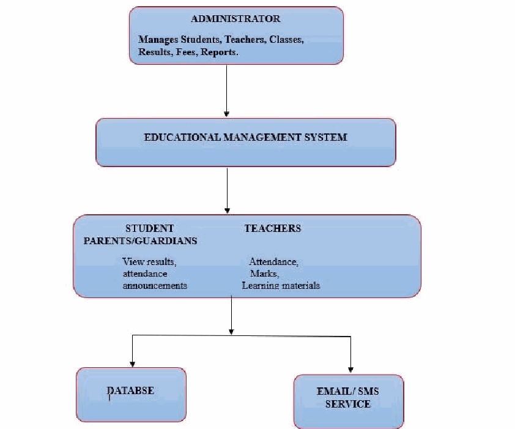
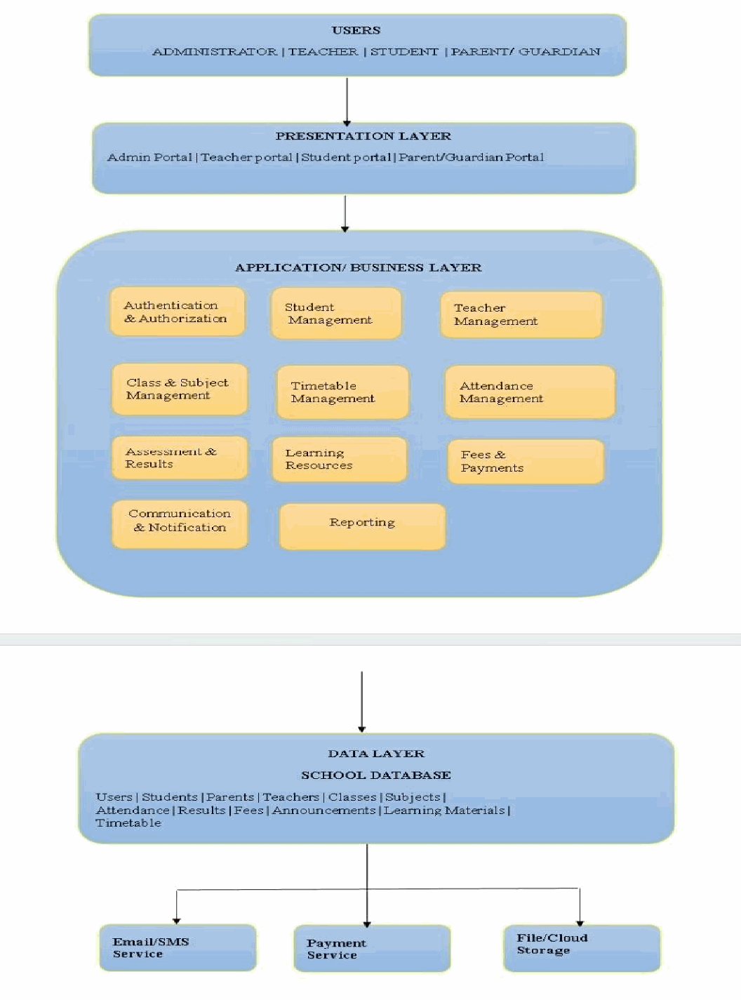
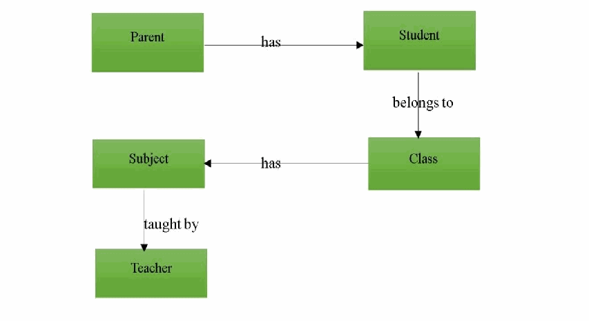
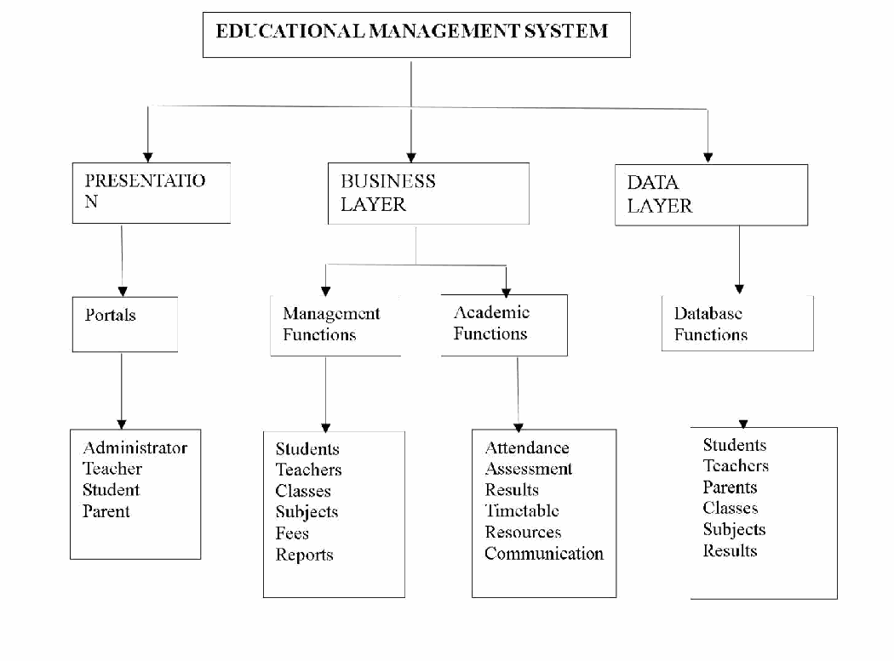

## UNIVERSITY OF GHANA DCIT 208 – SOFTWARE ENGINEERING

# DELIVERABLE 1

**Project Proposal, Feasibility and Business Considerations Team Name: DevForge**

Project Working Title: Unichild International School Website and Student Information Management System Contents: Part A – Executive Summary | Part B – Client, Users and Intended Use | Part C – Overall Functionality and Preliminary Requirements | Part D – Main System Components | Part E – Process and Milestone Plan | Part F – Business, Legal and Ethical Considerations | Part G – Risk Analysis

## D1- A: Executive Summary

**PROJECT TITLE** Unichild International School Website and Student Information Management System **CLIENT** Madam Phyllis Arthur

**PRIMARY AUDIENCES** Prospective parents, current students, staff and community

**CLIENT MOTTO** Lógia Kai Práxeis — Words and Actions Executive Summary “Unichild International School is an educational institution serving learners from Creche, Nursery, Kindergarten, Primary and Junior High School. The proposed project will develop a modern web-based platform that provides reliable school information to prospective parents, current students, staff and the wider community while supporting selected administrative and student-management activities. The client's requirements identify the need for a central online platform containing information about the school, its history, academics, admissions, departments, news, announcements, events, games and inter-school competitions. The system will also provide controlled accounts for students and teachers. After an administrator registers and admits a student, the administrator will create the student's account, through which the student can access results, fee status and other relevant information. Teachers will have accounts that allow them to view students and upload results, while the administrator will manage students, teachers, results, fee status and website content. The proposed solution will provide a centralized and accessible digital platform for communicating school information and managing selected student-related services. It will improve access to admission information, school announcements, academic information, events and contact channels, while giving authorized users access to information relevant to their roles. The system will also support downloadable and printable information, including student results, and provide school contact details, WhatsApp communication, a contact facility and location information.

**Task to Be Undertaken This Semester**

During the semester, the team will analyze, design, implement, test and prepare a working web-based solution for Unichild International School. The project will focus on the school's public-facing website, administrator functions, teacher and student accounts, admissions workflow, results and fee-status information, news and announcements, events/calendar, and games/inter-school competition information.

**Expected Value**

The expected value of the system is to provide Unichild International School with a centralized digital presence through which important information can be accessed more easily and selected administrative processes can be managed electronically. It will provide different user groups with role-appropriate access while improving the availability of school information and communication channels.

**What Will Not Be Built This Semester**

To prevent uncontrolled scope growth, the semester implementation will not include student self-admission because the client requires admission to be handled by the administrator. It will also not include integration with an existing social-media platform because the client confirmed that there is currently no existing website or social-media page requiring connection. Advanced fee-management processes beyond displaying fee status will remain outside the confirmed scope unless the client provides and approves additional requirements. The FAQ feature will also remain optional because the client has marked it as “Maybe” and therefore it is not yet a confirmed requirement.

## D1- B: Client, Users and Intended Use

**CLIENT** Phyllis Arthur **CONTACT** +233 244 891 066 / +233 558 636 562

**EMAIL** Unichildschool11@gmail.com

### B.1 Client Organization and Contact Person

The client for the UniChild International School Website Development Project is Phyllis Arthur. She is the designated contact person for the project and can be reached through +233 244 891 066 / +233 558 636 562 or via email at Unichildschool11@gmail.com.

### B.2 User Groups, Current Workflow and Pain Points

The proposed system is intended to serve Prospective Parents, Current Students, Staff, and the Community. The actual system users will also include the Administrator, Teachers, and Students. Currently, teachers record students' academic information and results manually using pen and paper or booklets. This process can be slower and more difficult to manage, particularly when dealing with information for many students. Accessing and organizing academic records through manual methods may therefore require additional time and effort. The proposed system will provide a more organized and efficient approach to recording, managing, and accessing student academic results.

### B.3 Intended Use After the Course

After the course, the Administrator will use the system to manage the platform, register and admit students online, create student accounts after admission, and manage student information, fee status, news, announcements, and events. Teachers will have individual accounts through which they can view relevant student information and upload academic results. Students will use their accounts to view their academic results and fee status. Parents and members of the public will mainly use the website to access information about the school, including academics, admissions, events, news, departments, competitions, and contact details.

### B.4 Three-Year Relevance

The proposed system is expected to remain useful beyond the semester because the school will continue to admit students, manage academic results, communicate announcements and events, and provide information to parents and the public. The system can also be updated as the school's programmes, admission information, and other content change. Therefore, the website and management system can continue supporting the school's administrative, academic, and communication activities over the next three years and beyond.

## C: Overall Functionality and Preliminary Requirements

**High-Level Feature List Grouped by User Role**

The proposed system will provide different features based on the role of each user. The following features are derived from the requirements gathered from Unichild International School.

### 1. Administrator

The administrator will have the highest level of access and will manage the main activities of the system. The administrator will be able to:

- Register and admit new students online.
- Create student accounts after admission.
- Manage student information.
- Manage teacher accounts.
- View and manage student records.
- Manage students' fee status.
- Manage admission information.
- Publish and manage school news and announcements.
- Create and manage school events and the academic calendar.
- Manage relevant school website content.
- Manage downloadable information.

### 2. Teachers

Teachers will have individual accounts and will be able to:

- Log into the system.
- View relevant student information.
- Upload students' academic results.

### 3. Students

Students will receive accounts created by the administrator after they have been admitted. They will be able to:

- Log into their accounts.
- View their academic results.
- Check their fee status to determine whether they are owing or not owing.
- Access other student-related information made available to them.

### 4. Parents and Prospective Parents

Parents and prospective parents will mainly use the public-facing website to:

- Learn about Unichild International School.
- View admission requirements and procedures.
- View admission fees and dates.
- View academic information.
- View school news and announcements.
- View school events and calendar information.
- Access relevant downloadable information.
- Contact the school through the available phone, email and WhatsApp channels.

**5. Community and Public Visitors** General visitors will be able to:

- View information about the school.
- View the school's academics, departments and programmes.
- View news and announcements.
- View games and inter-school competitions.
- View school building and event photographs.
- View contact and location information.
- Access the school's Google Maps location. Preliminary Functional Requirements (FR) The following functional requirements are preliminary and are based on the requirements gathered from the client. They may be refined further during the detailed Software Requirements Specification (SRS) stage. User Authentication and Accounts **FR01:** The system shall allow the administrator to log in securely. **FR02:** The system shall allow teachers to log in using their assigned accounts. **FR03:** The system shall allow students to log in using accounts created by the administrator after admission. **FR04:** The system shall restrict users to functions appropriate to their assigned roles. Student Admission and Management **FR05:** The system shall allow the administrator to register new students online. **FR06:** The system shall allow the administrator to admit registered students. **FR07:** The system shall allow the administrator to create a student account after admission. **FR08:** The system shall allow the administrator to view and manage student information. Teacher Functions **FR09:** The system shall allow teachers to view relevant student information. **FR10:** The system shall allow teachers to upload students' academic results. Student Functions **FR11:** The system shall allow students to view their academic results through their accounts. **FR12:** The system shall allow students to view their fee status. **FR13:** The system shall ensure that a student's academic results and personal information are accessible only to the appropriate authorized user. Academic Information **FR14:** The system shall provide information about the school's subjects. **FR15:** The system shall provide information about the school's curriculum. **FR16:** The system shall provide information about classes and academic programmes.

**Admissions Information FR17:** The system shall provide admission requirements. **FR18:** The system shall provide information about the admission application process. **FR19:** The system shall provide admission fee information. **FR20:** The system shall provide admission forms or relevant admission information. **FR21:** The system shall display admission dates. News, Announcements and Events **FR22:** The system shall allow the administrator to publish and manage school news and announcements. **FR23:** The system shall allow the administrator to create and manage school events. **FR24:** The system shall provide an event calendar containing relevant academic and school activities. **FR25:** The event calendar shall support information such as examinations, holidays, admission dates and parentteacher meetings.

**School Information and Public Website FR26:** The system shall provide information about the school, including its history, mission, motto and core values.

**FR27:** The system shall provide information about school departments. **FR28:** The system shall provide information about games and inter-school competitions. **FR29:** The system shall provide a gallery containing school building and school event photographs. Communication and Location **FR30:** The system shall display the school's official contact information. **FR31:** The system shall provide the school's email contact. **FR32:** The system shall provide a WhatsApp contact option. **FR33:** The system shall provide the school's location through Google Maps. **FR34:** The system shall display the school's office working hours. Downloads and Printing **FR35:** The system shall allow relevant About Us information to be downloaded in PDF format. **FR36:** The system shall allow relevant admission information to be downloaded in PDF format. **FR37:** The system shall allow students' results to be downloaded in PDF format. **FR38:** The system shall provide printable versions of relevant information and student results. Enquiries **FR39:** The system shall provide visitors with appropriate contact channels for making enquiries. **FR40:** The system shall display the school's phone number and email address for enquiries. Preliminary Non-Functional Requirements (NFR) The following preliminary non-functional requirements describe the expected quality and behaviour of the school management website.

**NFR01 — Usability**

The system should be simple and easy to use. Users should be able to navigate through the website and find information such as admissions, academics, events and contact details without difficulty.

**NFR02 — Reliability**

The system should work consistently and store important information such as student details, academic results and fee status accurately. The system should also handle errors without losing important data.

**NFR03 — Security**

The system should protect user accounts and school information. Administrator, teacher and student accounts should have appropriate access permissions so that users can only access functions and information relevant to their roles.

**NFR04 — Privacy**

Private information such as student personal details, academic results and fee status should not be publicly accessible. Such information should only be available to authorised users.

**NFR05 — Performance**

The website should load pages and perform normal operations within a reasonable time under the expected number of users. Images and other website content should also be managed so that they do not unnecessarily slow down the system.

**NFR06 — Maintainability**

The system should be organised and documented in a way that makes it easy for the development team or future developers to update, fix and add features when necessary.

**NFR07 — Accessibility**

The website should be designed so that different users can access and understand its content easily. It should use readable text, clear labels, simple navigation and a responsive layout that works on different screen sizes.

**Major Assumptions and Constraints Major Assumptions**

The following assumptions are made based on the information provided by the client:

- The administrator will be responsible for managing the system, including student registration, admission, accounts, news, announcements and events.
- Teachers will have their own accounts and will be able to view relevant student information and upload students' academic results.
- Student accounts will be created by the administrator after a student has been admitted.
- Students will use their accounts to access their academic results and fee status.
- The client will provide accurate school information, academic information, admission information, images and other content required for the website.
- The school will have internet access for administrators, teachers and students to use the system.
- The client will review and approve important website content before it is published.
- The website will provide fee information and students' fee status. Actual online fee payment processing is not included unless the client later confirms that it is required. Major Constraints
- Time constraint: The project must be completed within the academic project schedule and submission deadlines.
- Resource constraint: The development team has limited time and resources to design, develop, test and maintain the system.
- Client availability: Progress may depend on the availability of the client to provide information, review the system and give feedback.
- Information availability: The quality and completeness of the website will depend on the information, documents and media provided by the school.
- Security and privacy: Student personal information, academic results and fee status must be protected from unauthorised access.
- External services: Features such as Google Maps and WhatsApp may depend on the availability and policies of those external services.
- Scope changes: Additional features requested after development has started may require changes to the project schedule and workload.
- Technical limitations: The system will be developed using the technologies and resources available to the team, which may limit some advanced features.

D1-D: Main System Components

**Decomposition of the System into Logical/Architectural Components**

The proposed system is an Educational Management System (EMS) designed for an international school that provides education from the lower levels up to Junior High School (JHS). The system is intended to support the school's major academic and administrative activities. The main users of the system are administrators, teachers, students, and parents/guardians. The system can be divided into three main architectural layers:

- Presentation Layer
- Application/Business Logic Layer
- Data Layer These layers contain several functional components that work together to provide the required services.

#### D.1.1 Presentation Layer

The Presentation Layer is the part of the system that users interact with. It provides the different interfaces through which administrators, teachers, students, and parents can access the system. **a. Administrator Portal**

The administrator or school management can use the portal to:

- Register and manage students.
- Register and manage teachers.
- Create and manage classes.
- Add and manage subjects.
- Assign teachers to classes and subjects.
- Manage student attendance.
- Manage academic results.
- Manage school fees.
- ● Publish announcements. ● Generate school reports. Manage user accounts and access rights. b. Teacher Portal Teachers can use the system to:
- View their assigned classes.
- View subjects they teach.
- View their teaching timetable.
- Record student attendance.
- Enter student assessment marks.
- Upload learning materials.
- View student academic performance.
- Receive school announcements. c. Student Portal Students can use the system to:
- View their personal information.
- View their class and subjects.
- View their timetable.
- View attendance records.
- View examination and assessment results.
- Access learning materials.
- View school announcements. d. Parent/Guardian Portal Parents or guardians can use the system to:
- View their child's information.
- Monitor attendance.
- View academic results.
- View school announcements. ● View school fee information.

#### D.1.2 Application/Business Logic Layer

The Application Layer contains the main functional modules of the Educational Management System. It processes information received from users and applies the school's rules before information is stored or retrieved.

**a. Authentication and Authorization Component**

This component controls access to the system. Users log in using their credentials, and the system determines what they are allowed to access based on their role. For example: Administrator → Full system access; Teacher → Teaching-related functions; Student → Student functions; Parent → Child-related information. The component is responsible for:

- Login and logout.
- ● User account management.
- Password management. Role assignment.
- Access control.
- Account activation and deactivation. This component is important because sensitive information such as student results and financial records must not be accessible to unauthorized users. b. Student Management Component The Student Management component manages student information throughout their time at the school. Information stored may include:
- Student ID.
- Full name.
- Gender.
- Date of birth.
- Address.
- Parent/guardian information.
- Class.
- Admission date.
- Student status. The general process is: Register Student → Create Student Profile → Assign Student to Class → Record Academic Information → Maintain Student Records The administrator can add, update, search for, or deactivate student records. c. Teacher Management Component The Teacher Management component maintains information about teachers. The information may include:
- Teacher ID.
- Full name.
- Contact information.
- Email address.
- Subject(s) taught.
- Assigned class(es). For example: Teacher: Mr. Mensah → Subject: Mathematics → Classes: JHS 1, JHS 2 The administrator can assign teachers to particular classes and subjects. d. Class and Subject Management Component This component manages the classes and subjects offered by the school. Since the school ends at JHS, classes may include Creche, Nursery, Kindergarten, Primary 1–6, and JHS 1–3. Subjects may include:
- ● English Language.
- Mathematics.
- Integrated Science.
- Social Studies. Computing/ICT.
- French.
- Religious and Moral Education.
- Creative Arts.
- Physical Education.
- Other subjects offered by the school. The system can assign teachers to subjects and classes, for example: JHS 2 – Mathematics: Teacher A → English: Teacher B → Science: Teacher C → Computing: Teacher D e. Timetable Management Component The Timetable Management component is responsible for organizing lessons according to class, subject, teacher, day, time and classroom.

| Day | Time | Class | Subject | Teacher |
|---|---|---|---|---|
| Monday | 8:00–9:00 | JHS 2 | Mathematics | Mr. Mensah |
| Monday | 9:00–10:00 | JHS 2 | English | Mrs. Addo |
| Tuesday | 10:00–11:00 | JHS 2 | Science | Mr. Boateng |

Students and teachers can view their respective timetables through the system.

**f. Attendance Management Component**

The Attendance Management component allows teachers to record students' attendance, for example:

| Student | Date | Status |
|---|---|---|
| John Mensah | 09/09/2026 | Present |
| Mary Ann | 09/09/2026 | Present |
| David Smith | 09/09/2026 | Absent |

The process is: Teacher → Select Class → Select Date → View Student List → Mark Attendance → Save Record → Database The system can also generate attendance reports and allow parents to monitor their child's attendance.

**g. Assessment and Results Component**

This component manages the academic performance of students. Teachers can enter marks for activities such as class exercises, assignments, class tests, projects, mid-term examinations and end-of-term examinations. The system can calculate students' final scores according to the school's grading system, for example: Assignment = 20%, Class Test = 20%, Examination = 60%. The process is:

Teach●er → Select Class → Select Subject → Enter Marks → System Calculates Score/Grade → Store Result → Publish Result → Student/Parent Views Result This component allows teachers and school management to monitor student performance.

**h. Learning Resource Component**

The Learning Resource component allows teachers to upload educational materials for students, such as lesson notes, presentations, assignments, reading materials and practice questions.

The process is: Teacher → Select Subject → Upload Material → System Stores Material → Student Accesses Material This provides students with access to learning materials through the system.

**i. Communication and Notification Component**

This component provides a means of communication between the school and its users. The administrator can publish announcements about school events, examination dates, parent meetings, school holidays, changes in schedules and important reminders. The system can also support notifications through email or SMS if such services are integrated. For example: Administrator → Create Announcement → Educational System → Students / Teachers / Parents

**j. Fees and Payment Management Component**

This component maintains records of school fees. Information may include student, total fees, amount paid, outstanding balance, payment date and payment status. For example: Student: John Mensah, Total Fees: GHS 5,000, Amount Paid: GHS 3,500, Balance: GHS 1,500, Status: Partially Paid. The system can record payments and generate fee reports. For a relatively simple school system, an online payment gateway does not have to be included in the initial version — the system can simply record payments made through the school's existing payment methods.

**k. Reporting Component**

The Reporting component converts stored information into useful reports, including:

- Student reports: profile, academic performance, attendance, fee status.
- Class reports: number of students, attendance, academic performance, subject performance.
- School reports: total number of students, number of teachers, students per class, attendance statistics, academic performance. The reports can be used by school management to support decision-making.

#### D.1.3 Data Layer

The Data Layer stores and manages the information generated and used by the system. A relational database such as MySQL or PostgreSQL could be used. The database contains major data objects such as users, students, parents, teachers, classes, subjects, timetables, attendance, assessments, results, learning materials, fees, payments, announcements and notifications. The Data Layer ensures that information can be securely stored, retrieved, updated, and deleted when authorized.

**Why the Decomposition Is Appropriate**

The decomposition described above is appropriate for the proposed Educational Management System for several reasons.

### 1. Separation of Responsibilities

Each component has a specific responsibility. For example, the Attendance component deals with attendance, while the Results component deals with academic performance. This prevents all system functions from being placed into one large module. **2. Easier Maintenance**

Because the system is divided into modules, developers can modify one component without unnecessarily affecting the others. For example, changes to the Fees component should not require major changes to the Attendance component.

### 3. Improved Security

Different users require different levels of access. For example, a teacher can enter student marks, but a student should only be able to view their published results. The separation of user roles therefore helps protect sensitive school information.

### 4. Easier Testing

Each component can be tested independently, following the sequence: Authentication → Student Management → Teacher Management → Attendance → Assessment and Results → Fees → Reporting This makes it easier to identify and correct errors.

### 5. Scalability

The school can add additional functionality in the future without completely redesigning the system. Possible future additions include:

- Online examinations.
- Library management.
- School transportation management.
- Mobile application.
- Online learning.
- Hostel management, if required in the future.

### 6. Better User Experience

Different users can be given interfaces appropriate to their responsibilities. For example, teachers do not need to see administrative functions such as managing teacher accounts, while students do not need access to fee administration functions.

### 7. Appropriate for the School's Educational Level

The system is not designed like a university management system. It focuses on the activities that are relevant to an international school whose highest level is JHS. Therefore, unnecessary features such as university course-credit management, faculties, degree programmes, and university departments are excluded.

**Initial Context Diagram**

The following context diagram shows the Educational Management System and the major entities that interact with it.

**Explanation of the Context Diagram**

The Educational Management System is placed at the centre because it is the main system being developed. The four major external users are the Administrator, Teacher, Student, and Parent/Guardian. The database supports the system by storing information such as student records, attendance, results, and fees. Email/SMS services are optional external systems that can be integrated to send notifications.

### D.4 Initial Architectural Block Diagram

The following block diagram provides a more detailed view of how the major components communicate.

The system's major components communicate as described in the Application/Business Logic Layer above. The last three systems described under External Systems (email, SMS and payment gateway) are external and can be considered optional depending on the actual scope of the project.

**Major Data Objects**

| Data Object | Description |
|---|---|
| User | Stores login credentials and user roles |
| Student | Stores student personal and academic information |
| Parent/Guardian | Stores parent/guardian information |
| Teacher | Stores teacher information |
| Class | Stores class information such as Primary 1, JHS 2, etc. |
| Subject | Stores subjects taught in the school |
| Timetable | Stores lesson schedules |
| Attendance | Stores student attendance records |
| Assessment | Stores assessment information and marks |
| Result | Stores calculated/published academic results |
| Learning Material | Stores information about uploaded educational resources |
| Fee | Stores student fee information |
| Payment | Stores payment records |
| Announcement | Stores school announcements |
| Notification | Stores system notifications |

### D.6 Relationship Between the Major Data Objects

The major data objects interact as follows: a student belongs to a class, a class has several subjects, and each subject can be taught by a teacher. The student's attendance, academic results, and fee records are associated with that student.

- Student → Attendance
- Student → Assessment/Result
- Student → Fees
- Teacher → Learning Materials
- Administrator → Announcements

### D.7 External Systems

The Educational Management System can operate without many external systems. However, the following external systems may be integrated where necessary.

### 1. Email Service

Used for sending password reset messages, announcements, academic notifications and administrative messages.

### 2. SMS Gateway

An SMS service can be used for attendance alerts, important school announcements and parent notifications.

### 3. Payment Gateway

If the school decides to support online fee payments, a payment gateway can be connected to the system. The payment gateway would process the transaction while the Educational Management System records the payment status.

### 4. Cloud/File Storage

An external file storage service can optionally be used to store learning materials and other documents.

### D.8 Overall System Structure

The complete structure of the proposed system can therefore be summarized as:

**Conclusion**

The proposed Educational Management System is decomposed into logical components that reflect the actual activities of an international school from the lower levels up to JHS. The system consists mainly of user management, student management, teacher management, class and subject management, timetable management, attendance, assessment and results, learning resources, fees, communication, reporting, and database management. This decomposition is appropriate because it separates system responsibilities, improves security, simplifies maintenance and testing, and allows the school to expand the system in the future. The main external users are the administrator, teachers, students, and parents/guardians, while optional external systems include email/SMS services, payment gateways, and cloud storage. The architecture therefore provides a manageable and realistic structure for an international school's Educational Management System.

**D1 - E:** Process and Milestone Plan E.1 Chosen Development Process The team will use an Agile and iterative development process for the Unichild International School website and school management system. This approach will organise the work into short sprints, allowing the team to plan, design, develop, test, review and improve the system in manageable stages. Agile is appropriate because the system has several connected areas, including public school information, admissions, administrator-controlled student accounts, teacher functions, student results and fee status, news and announcements, events, downloads and communication features. Some details may require clarification during development. In particular, the client may refine teacher-account permissions and confirm the exact content for Games/Inter-school Competitions. At the end of each sprint, the team will review completed work, record defects or outstanding tasks, and incorporate approved feedback into the next sprint. New requests will be recorded in the backlog and assessed for priority, feasibility, dependencies, available time and effect on the agreed scope before they are included. This process will help the team to:

- develop confirmed requirements progressively;
- identify and correct defects early through continuous testing;
- keep the client involved when clarification or approval is required;
- maintain a traceable record of decisions, changes and team contributions; and • focus development time on the agreed high-priority requirements. Plan -> Design -> Develop -> Test -> Review -> Refine E.2 Sprint Plan: Week 6-12 The sprint plan below keeps development activity and course deliverables visible from Week 6 to Week 12.

| Week | Sprint / Stage | Main Activities | Expected Outcome |
|---|---|---|---|
| Week 6 | Sprint 1: Planning and UX | Review the approved requirements; prioritise backlog items; create tasks; confirm user roles; begin userinterface planning and workflows. | D3 - Backlog & UX |
| Week 7 | Sprint 1: Core structure | Set up the main website and application structure; begin | D4 - Architecture Baseline |
|  |  | selected high-priority features; document technical |  |
|  |  | decisions. |  |
| Week 8 | Sprint 1: Prototype and review | Develop and test an initial end-to-end core flow; review defects and record feedback or carry-over work. | D5 - Prototype v0.1 |
| Week 9 | Sprint 2: Feature development | Implement further approved functions, such as relevant | D6 - Beta v0.2 |
|  |  | administrator, student or teacher capabilities; continue |  |
|  |  | functional testing. |  |
| Week 10 | Sprint 3: Integration and quality | Integrate major components; test user roles, permissions and data validation; resolve priority defects. | D7 - Staging v0.3 |
| Week 11 | Sprint 4: Release candidate | Complete approved priority functionality; carry out | D8 - Release Candidate v0.9 |
|  |  | regression testing; improve user documentation and |  |
|  |  | release preparation. |  |
| Week 12 | Final Review & Preparation | Conduct final review; prepare the demonstration; complete documentation; incorporate approved final corrections and prepare handoff evidence. | D9 - Final Demo v1.0; D10 - Final Handoff v1.0 |

E.3 Project Milestones The following milestones correspond with the DCIT 208 deliverables and will be used to monitor progress throughout the project.

| Milestone | Deliverable | Purpose |
|---|---|---|
| 1 | D1 - Project Proposal | Defines the project scope, proposed solution, process, risks and business considerations. |
| 2 | D2 - Requirements Baseline | Records the agreed functional and non-functional requirements. |
| 3 | D3 - Backlog & UX | Produces prioritised backlog items, user stories, workflows and interface designs. |
| Milestone | Deliverable | Purpose |
| 4 | D4 - Architecture Baseline | Defines the technical architecture, major components and development |
|  |  | approach. |
| 5 | D5 - Prototype v0.1 | Demonstrates an initial working version with selected core functionality. |
| 6 | D6 - Beta v0.2 | Provides an expanded version for testing, review and improvement. |
| 7 | D7 - Staging v0.3 | Integrates major components and prepares the system for wider testing. |
| 8 | D8 - Release Candidate v0.9 | Completes approved priority functionality and final testing before release. |
| 9 | D9 - Final Demo v1.0 | Demonstrates the completed system and its agreed major functions. |
| 10 | D10 - Final Handoff v1.0 | Completes final documentation, required evidence and project handover. |

E.4 Project Visibility Plan The team will keep the client, team members and lecturer informed through regular communication, visible project evidence and milestone reviews. Client visibility The client will receive progress updates and review working versions where appropriate. The team will request clarification when a requirement is unclear or requires refinement. Client feedback, approvals and agreed changes will be recorded so that development remains aligned with confirmed requirements. Team-member visibility Team members will use the shared project repository and agreed communication channels to coordinate their work and keep task progress visible.

- GitHub Issues or an agreed project board for task assignment and status tracking.
- Branches, commits and pull requests to show individual development work and code review.
- Regular team discussions to report progress, identify blockers and coordinate upcoming work.
- Project documentation to record important technical decisions, tests and changes. Lecturer visibility The lecturer will be able to follow the project through the repository, documented evidence and the required course deliverables. Relevant evidence will include:
- commits, branches, issues and pull requests;
- testing evidence, version or release records and project documentation;
- client feedback and decision records where applicable; and
- completed DCIT 208 deliverables submitted through the approved course process. This visibility plan will make progress traceable and verifiable while giving the team opportunities to refine the system without introducing unapproved scope.

## D1-F: Business, Legal, and Ethical Considerations

**Course Deliverable** Deliverable D1 (F) — Project Proposal, Feasibility & Business Considerations **Client Name & Org** Mrs Phyllis Arthur, Unichild International School

DevForge | GitHub Repo: git@github.com:niipascal51-tech/unichild-

**Team Name & Repo**

internationalschool_webproject.git

**Submission Date** Monday 14 September 2026 Software engineering projects operating within real-world deployment contexts must carefully navigate statutory, contractual, and ethical frameworks. This section outlines the legal, intellectual property, data protection, risk management, and warranty governance established for this client project under the DCIT 208 Software Engineering course at the University of Ghana.

### F.1 Copyright and Intellectual Property (IP) Licensing Plan

To reconcile the academic evaluation requirements of the Department of Computer Science with the operational needs of the client organization, a clear dual-structured Intellectual Property (IP) agreement has been established between the engineering team and the client.

#### F.1.1 Ownership vs. Licensing Arrangement

- Underlying Code Ownership: The student development team retains the underlying authorial copyright and intellectual property rights to the custom source code, documentation, and architecture engineered during the course for academic verification, portfolio demonstration, and educational submission.
- Client Non-Exclusive License Grant: Upon successful project completion and final deliverable freeze (October 23, 2026), the client is formally granted a perpetual, non-exclusive, worldwide, royalty-free, and irrevocable operational license to deploy, execute, host, modify, and maintain the application software for their internal business operations.
- Client Asset Retention: All pre-existing trademarks, logos, client-owned business data, proprietary domain content, and client brand assets remain the exclusive intellectual property of the client organization.

#### F.1.2 Scope of Permitted Client Operations

Under the non-exclusive license agreement, the client possesses full legal authorization to perform the following activities without additional royalty payments or licensing fees:

- Deploy the software application across cloud servers, on-premise infrastructure, or third-party web hosts.
- Modify, refactor, and update the source code internally or through third-party software developers postcourse.
- Create derivative works, additional modules, or API extensions to support organizational growth.
- Grant user access to client employees, registered customers, and authorized stakeholders.

#### F.1.3 Restrictions on Re-licensing, Resale, and Dual-Licensing

To prevent commercial conflict during the active academic development period, neither party may commercialize, resell, sub-license, or package the custom codebase as a standalone white-label product for third-party commercial distribution without a separate, written post-course agreement signed by both the client representative and student team members.

#### F.1.4 Course Repository & Institutional Access Disclosure

In compliance with DCIT 208 Rule 3 and Rule 9, the complete source code, documentation, test suites, and deployment infrastructure scripts must be committed to the official GitHub Classroom repository and uploaded to the Sakai LMS for grading by University of Ghana faculty. The client acknowledges that university evaluators have read/review access to the code repository solely for academic grading and verification purposes.

### F.2 Open-Source Software (OSS) Integration & License Compliance

Modern software engineering relies heavily on third-party libraries, open-source frameworks, and external APIs. To prevent legal liability, license contamination, or breach of open-source terms, the team strictly adheres to an Open-Source License Compliance Plan.

#### F.2.1 Permissive vs. Copyleft Licensing Policy

- Permissive First Strategy: The project architecture prioritizes packages distributed under standard Permissive Open-Source Licenses (e.g., MIT License, Apache License 2.0, BSD 2-Clause/3-Clause, ISC). These licenses permit free incorporation, modification, and static/dynamic linking without forcing the rest of the proprietary client codebase to be open-sourced.
- Strong Copyleft Prohibition: Third-party libraries governed by Strong Copyleft licenses (e.g., GNU GPL v2/v3, AGPL) are strictly banned from inclusion in backend or frontend core binaries. This prevents viral licensing obligations that could compel the public release of the client's proprietary business rules.
- Weak Copyleft (LGPL) Isolation: Libraries under Weak Copyleft licenses (e.g., GNU Lesser GPL / LGPL) are permissible only when consumed as dynamic, un-modified shared dependencies via package managers (npm, pip, composer).

#### F.2.2 Automated Software Bill of Materials (SBOM) & Dependency Audit

To track open-source dependencies and fulfill license attribution requirements, the continuous integration pipeline includes automated dependency manifest checking:

- Package lockfiles (package-lock.json, requirements.txt, composer.lock) are committed to record precise library versions.
- Automated CI tools (GitHub Dependabot, Snyk, and license-checker) run static analysis on every Pull Request to flag license violations or security vulnerabilities.
- A root THIRD_PARTY_NOTICES.md document is automatically generated prior to release containing copyright notices and license text for all third-party components.

#### F.2.3 Open-Source Dependency & Compliance Matrix

Table F.1 summarizes the core open-source frameworks, third-party libraries, and external services integrated into the application, alongside their licensing models and compliance obligations.

| Layer / Component | Library / Framework | License Type | Compliance Action Required |
|---|---|---|---|
| Frontend UI Framework | React / Vue.js / Tailwind CSS | MIT License | Retain copyright notice in bundled JavaScript build files. |
| Backend Web Framework | Node.js (Express) / Python (FastAPI/Django) / PHP (Laravel) | MIT / BSD / Apache 2.0 | Maintain license headers in server deployment environment. |
| Database Engine | PostgreSQL / MySQL / SQLite | PostgreSQL License / GPL v2 (Client Link) / Public Domain | Use standard client connector libraries (e.g. pg, mysql2) avoiding proprietary engine modifications. |
| Authentication & Security | JSON Web Token (jsonwebtoken) / bcrypt | MIT License | Include license text in THIRD_PARTY_NOTICES.md. |
| HTTP Client & Utilities | Axios / Guzzle / Requests | MIT License | Preserve copyright headers in distribution packages. |

### F.3 Data Protection, Privacy, and Confidentiality Protocols

Handling client data and user metrics introduces statutory compliance responsibilities. The application design strictly aligns with national data protection legislation and privacy-by-design engineering principles.

#### F.3.1 Statutory Framework: Ghana Data Protection Act, 2012 (Act 843)

Because the software system is deployed within Ghana and processes user information of Ghanaian citizens/residents, all data handling workflows strictly conform to the principles of data protection mandated by the Ghana Data Protection Commission (DPC) under Act 843:

- 1. Accountability & Lawfulness: Data processing must have explicit user consent or legal necessity.
- 2. Minimal Collection: Data collected is restricted strictly to features necessary for system functionality.
- 3. Purpose Specification: Personal data will not be repurposed or transferred to unauthorized third parties.
- 4. Data Quality & Accuracy: Mechanisms exist for users to update, verify, or correct personal profiles.
- 5. Data Subject Participation: Users retain rights to access, object to processing, or request account deletion.
- 6. Security Safeguards: Robust encryption, access control, and vulnerability management protect records.

#### F.3.2 Data Classification & Sensitivity Framework

System data is categorized into explicit sensitivity tiers to enforce proportional security controls:

| Classification Level | Data Elements Included | Storage & Transmission Protocol | Access Authorization |
|---|---|---|---|
| Public Data | Public course info, marketing descriptions, non-sensitive system documentation. | Standard HTTP/HTTPS delivery; public repository docs. | Unrestricted public access. |
| Internal Operational Data | System audit logs, aggregated performance metrics, application state. | Encrypted database; TLS 1.3 in transit. | Authenticated client staff and system admins. |
| Confidential PII Data | User names, email addresses, telephone numbers, encrypted passwords, password hashes. | AES-256 field/disk encryption; TLS 1.3 transit; Argon2id password hashing. | Restricted to owning user and authorized role (RBAC). |
| Restricted / Private Secrets | Database credentials, API secret keys, JWT signing keys, OAuth tokens. | Stored in environment variables (.env / GitHub Secrets); strictly excluded from source code. | System Administrator & DevOps Lead only. |

#### F.3.3 Technical & Organizational Security Measures (TOMs)

- In-Transit Encryption: All network interactions require HTTPS secured via TLS 1.3 certificates. Unencrypted HTTP traffic is automatically redirected.
- Password & Credential Hashing: Passwords are never stored in plain text. All user credentials are hashed using Argon2id or bcrypt with high work factors and unique salts.
- Role-Based Access Control: Access to backend endpoints and database records is governed by strict Role- Based Access Control (RBAC), adhering to the Principle of Least Privilege.
- Sanitised Development Data: In compliance with DCIT 208 Non-Negotiable Rule 9, actual client passwords, live customer database records, tokens, or personal identifiers will NEVER be committed to GitHub or uploaded to public AI tools.

#### F.3.4 Data Retention, Deletion, and Staging Purge Policy

Temporary test accounts, mock database records, and continuous integration testing artifacts created during development sprints will be completely purged from staging environments prior to the final release candidate (v0.9-rc) and client handoff. Users retain the right to request deletion of their account records via administrative request.

### F.4 Proprietary Data, NDAs, Patents, and Conflict of Interest Management

#### F.4.1 Non-Disclosure Agreements (NDAs) & Proprietary Client Workflows

During requirement elicitation (D0/D1), the team receives operational insights into the client's internal processes. The team commits to treating all client operational metrics, financial workflows, trade secrets, and internal administrative structures as strictly Confidential Information.

#### F.4.2 Trade Secret & Secret Key Governance

- Secrets, private tokens, and API credentials are kept out of source code and stored exclusively in environment variables (.env).
- The .gitignore file is configured and verified to prevent accidental commits of local settings or credential files.
- Automated CI secret scanning runs on all commits to block PR merges containing potential secret leaks.

#### F.4.3 Patent and Trademark Non-Infringement Analysis

- The project working title and UI styling avoid trademarked names or copied corporate design systems.
- The application architecture utilizes standard, publicly established software engineering workflows (MVC, REST APIs, microservices) and does not infringe on registered software utility patents.

#### F.4.4 Conflict of Interest (CoI) Governance

- Independent Engineering: No team member holds direct financial stake, ownership interest, or paid employment with the client organization that compromises objective software engineering practices.
- Client Independence: No member is serving as their own client, in direct compliance with DCIT 208 Rule 1.

### F.5 Formal Academic Disclaimer and No-Warranty Clause

Because this software project is engineered by undergraduate students as an academic requirement for DCIT 208: Software Engineering at the University of Ghana, a clear legal disclaimer governs client deployment.

**FORMAL ACADEMIC DISCLAIMER & NO-WARRANTY CLAUSE**

1. ACADEMIC NATURE OF WORK: This software system is produced by undergraduate students solely for educational evaluation and course demonstration under the DCIT 208 curriculum. It does not represent a commercial software product manufactured by commercial enterprise software vendors.

2. 'AS IS' WARRANTY DISCLAIMER: THE SOFTWARE IS PROVIDED 'AS IS', WITHOUT WARRANTY OF ANY KIND, EXPRESS OR IMPLIED, INCLUDING BUT NOT LIMITED TO THE WARRANTIES OF MERCHANTABILITY, FITNESS FOR A PARTICULAR PURPOSE, TITLE, AND NON-INFRINGEMENT. IN NO EVENT SHALL THE STUDENT AUTHORS, THE COURSE LECTURERS, THE DEPARTMENT OF COMPUTER SCIENCE, OR THE UNIVERSITY OF GHANA BE LIABLE FOR ANY CLAIM, DAMAGES, OR OTHER LIABILITY, WHETHER IN AN ACTION OF CONTRACT, TORT, OR OTHERWISE, ARISING FROM, OUT OF, OR IN CONNECTION WITH THE SOFTWARE OR THE USE OR OTHER DEALINGS IN THE SOFTWARE.

3. LIMITATION OF LIABILITY: Under no circumstances shall the student team or the University of Ghana be held liable for operational downtime, lost profits, financial losses, data corruption, security breaches, or indirect damages resulting from client deployment.

4. HANDOFF & MAINTENANCE BOUNDARY: Student maintenance responsibilities terminate upon the conclusion of the academic semester (October 23, 2026 / Final Freeze). Any ongoing technical support, bug fixes, or feature enhancements post-course require a separate, mutually agreed contract between the client and individual team members.

### F.6 Formal Section Approval & Acknowledgement

By submitting this proposal deliverable, all team members acknowledge and commit to the legal, business, data protection, and ethical standards set forth in this Section F.

| Team Role | Student Name & ID | Sign-Off Status / Date |
|---|---|---|
| Product / Client Manager & Team | Eric Omari | Approved — 14 Sep 2026 |
| Front-End Developer | Bright Dadzie (ID: 22414604) | Approved — 14 Sep 2026 |

## D1-G: Risk Analysis

**Top Ten Project Risks**

| Risk | Prob. | Impact | Owner | Mitigation |
|---|---|---|---|---|
| Client (Mrs. Phyllis Arthur) becomes hard to reach during school term, especially around exam periods and staff meetings | Medium | High | Product/Client Manager | Agree with a fixed weekly check-in slot (e.g. Friday afternoons) in week 1; get a deputy contact at the school (e.g. a vicehead teacher or ICT coordinator); escalate internally if there is no response after 5 working days. |
| School has limited or unreliable computers/internet for staff and students to actually use the system | Medium | High | Architecture and Context Lead | Confirm the school's real device and connectivity situation during intake; design for low-bandwidth use (lightweight pages, offline-friendly where possible); avoid assuming every user has a personal device. |
| System handles data belonging to minors (students under 18), raising privacy and safeguarding obligations | Medium | High | QA/Validation Lead | Limit collected student data to what the school actually needs; restrict access by role (teacher/admin only where appropriate); document this explicitly in the NFR and data-sensitivity sections of the SRS. |
| A team member drops the course, disengages, or becomes unreachable mid- semester | Low- Medium | High | Product/Client Manager | Cross-train on critical roles so no single person is a bottleneck; follow the nonparticipation clause already agreed in the D0 team charter; escalate to the lecturer if unresolved after one sprint. |
| Team's inexperience with the chosen stack (low-bandwidth users) slows early sprints | Medium | Medium- High | Architecture and Context Lead | Research and agree on low-bandwidth design patterns before sprint 1 starts (minimal JS bundles, compressed images, server-rendered pages, caching static assets); test the prototype on a throttled connection or low-end device early rather than waiting until D5; keep a fallback plan to strip non-essential features if performance testing shows problems. |
| Scope creep as the client requests more features than a semester allows (e.g. full school management suite) | Medium | Medium | Product/Client Manager | Lock a 'will not build this semester' list in the proposal; route new requests into the backlog rather than immediate implementation; re-confirm scope with the client at each sprint review. |
| School's academic calendar (exams, mid- term break, staff availability) collides with sprint deadlines | Medium- High | Medium | Product/Client Manager | Get the school's term calendar during intake and map it against the sprint plan; schedule client demos and feedback sessions around school-quiet periods, not exam weeks. |
| Free-tier hosting/deployment limits (bandwidth, storage, sleep-on-idle) affect demo or staging reliability | Medium | Low- Medium | DevOps/Release Lead | Choose a hosting provider with education-friendly free tiers early; test under realistic load before D4 and D9; keep a documented fallback deployment option. |
| AI-generated code or content is merged without adequate review, introducing bugs or hallucinated logic | Medium | Medium | QA/Validation Lead | Require at least one human reviewer and a passing test on every AI-assisted PR before merge; log every AI-assisted change in AI_USAGE.md with what was verified and by whom. |
| Risk | Prob. | Impact | Owner | Mitigation |
| Teachers/staff show low adoption after handoff due to unfamiliarity with the system | Medium | Medium | UX/Research Lead | Involve school staff in usability checks before D9; keep the interface simple and mirror existing paper-based workflows where possible; provide a clear, screenshot-based user manual and a short training walkthrough at handoff. |

**Client Availability Risk and Fallback Plan**

Mrs. Phyllis Arthur, as the school's point of contact, has other administrative and teaching responsibilities and is not always immediately reachable, particularly during exam weeks, staff meetings, or the start/end of term. Fallback plan:

- Agree a fixed weekly or bi-weekly check-in slot with the client in week 1, and confirm the best channel (WhatsApp, email, or phone call).
- Identify a deputy contact at the school — for example a vice-headteacher, ICT coordinator, or senior teacher — who can validate requirements if the primary contact is unavailable.
- If no response is received within 5 working days of a scheduled check-in, the Product/Client Manager escalates by trying alternate contact channels, then flags the issue to the lecturer if it continues to affect the timeline.
- If the client relationship breaks down entirely, the team falls back on already-validated requirements and documented assumptions and seeks a substitute client (e.g. another school contact) with lecturer guidance. Technical Risk and Fallback Plan The team's limited prior experience with the chosen stack (React/Node, or equivalent) creates a risk of slow progress in early sprints, particularly around authentication, role-based access for teachers/admins/students, and reliable deployment for a school with modest infrastructure. Fallback plan:
- Run a short technical spike in week 1–2 on the riskiest part of the system (for example, login and rolebased access) before committing to the full architecture.
- Pair less experienced implementers with the Architecture and Context Lead during early feature work.
- If the chosen stack is clearly not working out by week 3 (based on velocity and CI evidence), fall back to a simpler, more familiar stack rather than persisting and losing further sprint time. Team Participation Risk and Escalation Process As with any student team, there is a risk of uneven contribution, missed meetings, or a member becoming unreachable mid-semester. This risk and its consequences were already defined in the D0 team charter and are restated here for consistency.
- Step 1: A direct, documented conversation between the affected member and the rest of the team, with the concern and agreed next step recorded in the meeting minutes.
- Step 2: If unresolved after one sprint, the Product/Client Manager formally raises it with the team and documents the pattern (missed commits, missed meetings, unassigned issues).
- Step 3: If participation still does not improve, the issue is escalated to the lecturer, with repository evidence (commits, PRs, issues) used to support the case, consistent with the non-participation consequences agreed in TEAM.md. AI Misuse Risk and Verification Plan AI tools may be used to accelerate design, boilerplate code, and documentation, but unverified AI output introduces real risk: hallucinated library functions or APIs that do not exist, code that looks correct but contains subtle logic errors, and the risk of a team member pasting confidential client or student data into a public AI tool. Verification plan:
- No AI-generated or AI-assisted code is merged without review from a non-author team member and at least one passing test.
- Every instance of AI assistance is logged into AI_USAGE.md, including the tool used, the task, what was accepted or rejected, and how it was verified.
- Client and student data (names, grades, contact details) must never be pasted into public AI tools; anonymized or placeholder data is used instead when AI help is needed with data-related logic.
- Any team member using AI-assisted code must be able to explain what it does and why it works, since inability to explain submitted work forfeits individual credit under the course's non-negotiable submission rules.”
