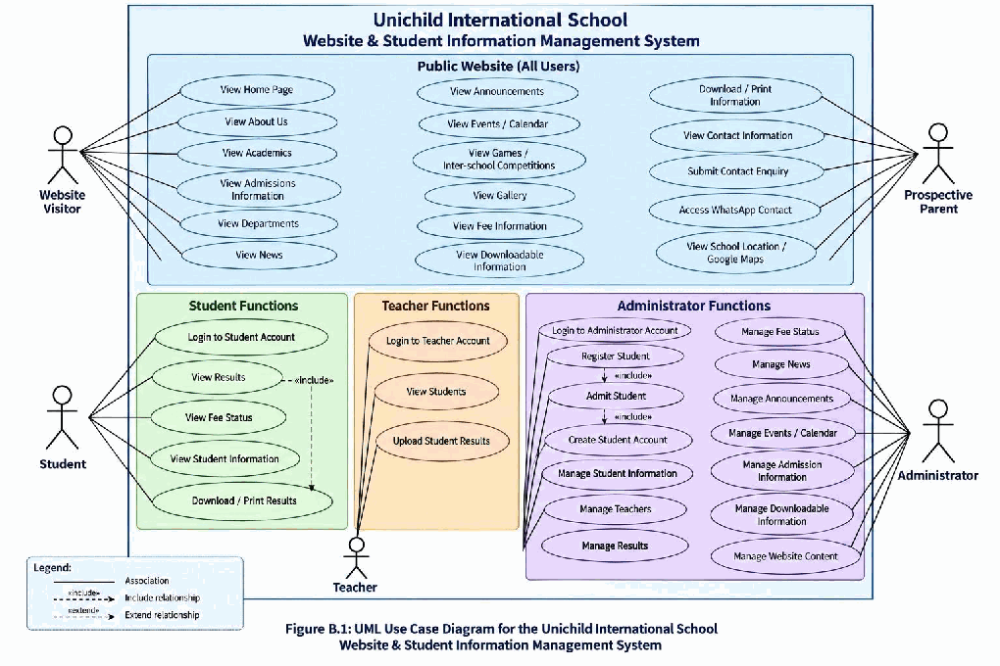
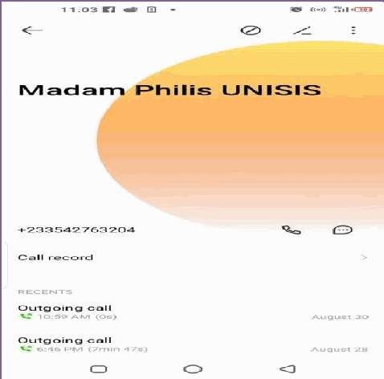
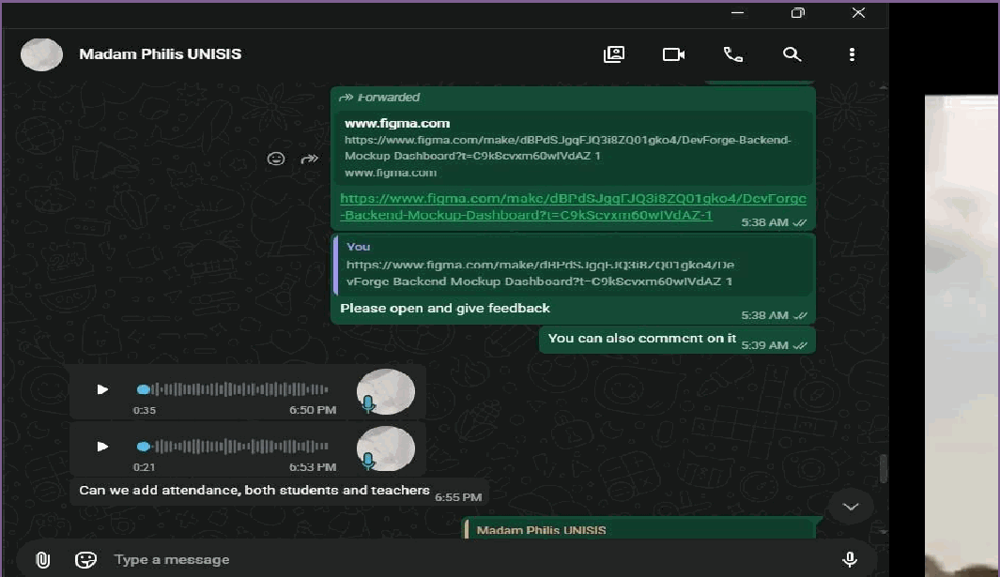
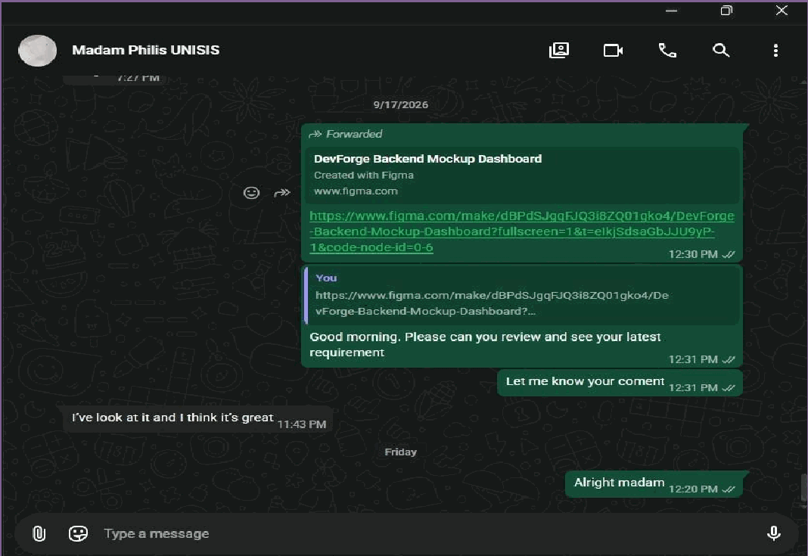
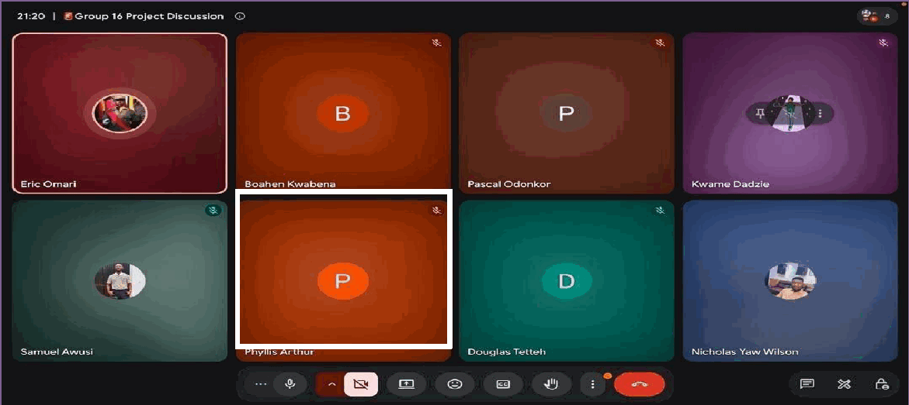

**UNIVERSITY OF GHANA DCIT 208 – SOFTWARE ENGINEERING DELIVERABLE 2**

## Team Name: DevForge

“Project Working Title: Unichild International School Website and Student Information Management System

**Contents: Part A – Executive Summary / Overview Part B – Use Case Model Part C – User Stories Part D – Non-Functional Requirements Part E – Data and External Interface Requirements Part F – Glossary and Validation Evidence**

DCIT 208 Software Engineering | D2 Section A | Unichild International School

**UNIVERSITY OF GHANA DEPARTMENT OF COMPUTER SCIENCE DCIT 208 – SOFTWARE ENGINEERING D2: SOFTWARE REQUIREMENTS SPECIFICATION SECTION A – REQUIREMENTS OVERVIEW**

Unichild International School – Software Requirements Specification

DCIT 208 Software Engineering | D2 Section A | Unichild International School

### 1. Requirements Overview

#### 1.1 Purpose

This Software Requirements Specification (SRS) Section A establishes the requirements baseline for the proposed Unichild International School website and school management system. The purpose is to translate the client’s stated needs into a clear description of the system purpose, scope, boundary, stakeholders, user roles and high-level functional requirements. This section also records the assumptions, constraints and dependencies that must guide later design, backlog and implementation work. The DCIT 208 instructions state that D2 should move the project from a vague client need to precise, testable and traceable requirements. Section A specifically requires the purpose, scope and system boundary, stakeholder map and user roles, a high-level functional-requirements narrative, and assumptions, constraints and dependencies.

#### 1.2 Project Purpose and Problem Context

Unichild International School requires a new website and associated management functions to present school information to prospective parents, current students, staff and the wider community while providing controlled access to selected student and staff functions. The client has stated that there is no existing website or social media page that needs to be connected to the new system. The system is intended to bring public school information and selected school-management activities into one platform. Public-facing information includes school introduction, history, academics, admissions, news and announcements, events, games/inter-school competitions, gallery and contact information. Authenticated functions include administrator-controlled student registration and admission, student account creation, student results and fee-status access, and teacher access for viewing students and uploading results.

#### 1.3 Scope

##### 1.3.1 In-Scope Functions

- Public school website with Home, About Us, Academics, Admissions, News/Blog, Departments, Games/Inter-school Competitions, Gallery and Contact-related content.
- Home page containing school introduction, motto, core values, announcements, upcoming events, admission information, contact information, WhatsApp contact and navigation to major sections.
- About Us content covering school history, biography, mission statement, motto, core values and other client-supplied information.
- Academics information covering subjects, curriculum, classes and academic programs.
- Admissions information covering requirements, application process, admission fees, admission forms and admission dates.
- Administrator-controlled student registration and admission, followed by student account creation.
- Student accounts through which admitted students can access results, fee status and other student- related information provided by the system.
- Teacher accounts allowing teachers to log in, view students and upload students’ results.

Unichild International School – Software Requirements Specification

DCIT 208 Software Engineering | D2 Section A | Unichild International School

- Administrator account for managing students, teachers, results, fee status, news, announcements, events/calendar, admission information, downloadable information and other website content.
- News/blog management in which the administrator can create, edit, publish and remove news.
- Events/calendar covering academic calendar, school events, Parent–Teacher Meetings, examinations, admission dates, holidays, news and announcements.
- Games/inter-school competitions section for competitions, games, results, events, achievements and photos, with exact content to be confirmed later.
- Gallery containing photos of school buildings and school events.
- Fee-status display for student accounts showing whether the student is owing or not owing.
- Download and print functions for About Us information, admission information and student results; student results should be available in PDF and printable form.
- Contact and communication information including school phone numbers, email, WhatsApp contact, contact information/form, Google Maps/location and office hours.

##### 1.3.2 Out-of-Scope / Not Confirmed for This Baseline

The client requirements do not confirm several additional functions. These should not be treated as confirmed D2 requirements until the client validates them. In particular:

- FAQ functionality is optional/pending confirmation because the client answered “Maybe”.
- Exact teacher permissions beyond viewing students and uploading results are pending further client requirements.
- The exact fee-management process is pending finalization with the backend team.
- The exact content structure for Games/Inter-school Competitions is pending confirmation.
- No integration with an existing school website or social media platform is required based on the client’s current statement.
- Payment processing is not specified in the supplied client requirements and is therefore not included as a confirmed requirement.

#### 1.4 System Boundary

The system boundary separates functions handled by the Unichild platform from activities and systems outside the confirmed requirements. The platform boundary includes the public website, content management functions, administrator functions, teacher functions, student accounts, student results, fee-status information, admissions management and downloadable/printable information. Actors and external points at the boundary include:

| Actor / External Point | Interaction with System | Boundary Status |
|---|---|---|
| Prospective Parents | Browse school information, admissions information and contact details; make enquiries using available contact channels. | External user |
| Current Students | Log in after an administrator creates an account; access | Authenticated user |

Unichild International School – Software Requirements Specification

DCIT 208 Software Engineering | D2 Section A | Unichild International School

|  | results, fee status and other permitted student information. |  |
|---|---|---|
| Teachers | Log in, view students and upload students’ results. | Authenticated user |
| Administrator / Client | Registers and admits students; creates accounts; manages students, teachers, results, fee status and website content. | System administrator |
| Community / Visitors | Access public school information, announcements, events, gallery and contact information. | Public user |
| Email / WhatsApp / Phone / Google Maps | Referenced as communication or location facilities in the website | External services/information; exact technical integration not |
|  | requirements. | specified |

#### 1.5 Stakeholder Map and User Roles

| Stakeholder / Role | Primary Interest | Main Responsibilities / Needs | Access Type |
|---|---|---|---|
| Unichild International School / Client | Accurate online representation and school management | Controls admissions, students, teachers, results, fee status and website content. | Administrator |
| Administrator | Operational control of the system | Register/admit students; create accounts; manage records, results, fees, news, announcements, events and other content. | Privileged authenticated |
| Teacher | Student academic management | View students and upload results. | Authenticated teacher |
| Current Student | Access personal school information | View results, fee status and other permitted student information. | Authenticated student |
| Prospective Parent | School and admissions information | Browse school information and admissions details; make enquiries. | Public visitor |

Unichild International School – Software Requirements Specification

DCIT 208 Software Engineering | D2 Section A | Unichild International School

| Community | General school information | Access public website information, events, achievements, gallery and contacts. | Public visitor |
|---|---|---|---|

#### 1.6 High-Level Functional Requirements Narrative

| ID | Requirement Area | High-Level Requirement |
|---|---|---|
| FR-01 | Public Website Navigation | The system shall provide public access to the major schoolinformation sections, including Home, About Us, Academics, Admissions, News/Blog, Departments, Games/Inter- school Competitions and Gallery/contact information. |
| FR-02 | Home Page | The system shall display school introduction, motto, core values, announcements, upcoming events, admission information, contact information, WhatsApp contact and navigation to major sections. |
| FR-03 | About Us | The system shall present school history, biography, mission statement, motto, core values and other relevant client- supplied content. |
| FR-04 | Academics | The system shall present subjects, curriculum, classes and academic programs. |
| FR-05 | Admissions | The system shall present |

|  |  | admission requirements, application process, admission fees, admission forms and admission dates. |
|---|---|---|
| FR-06 | Student Registration and Admission | The system shall allow the administrator/client to register and admit students online. Students shall not |

Unichild International School – Software Requirements Specification

DCIT 208 Software Engineering | D2 Section A | Unichild International School

|  |  | independently admit themselves. |
|---|---|---|
| FR-07 | Student Account Creation | After admission, the administrator shall create the student’s account. |
| FR-08 | Student Information Access | The system shall allow authenticated students to access results, fee status and other student-related information provided by the system. |
| FR-09 | Fee Status | The system shall show an authenticated student whether the student is owing or not owing. |
| FR-10 | Teacher Login and Functions | The system shall provide teacher login and allow authenticated teachers to view students and upload students’ results. |
| FR-11 | Administrator Management | The administrator shall manage student information, teachers, results, fee status, admission information and website content. |
| FR-12 | News Management | The administrator shall be able to create, edit, publish and remove news. |
| FR-13 | Announcements | The website shall display announcements, with posting controlled by the administrator/client. |
| FR-14 | Events and Calendar | The system shall provide an event/calendar feature for academic calendar items, school events, Parent–Teacher Meetings, examinations, admission dates, holidays, news and announcements. |

Unichild International School – Software Requirements Specification

DCIT 208 Software Engineering | D2 Section A | Unichild International School

| FR-15 | Games and Competitions | The system shall provide a section for games/inter-school competitions, accommodating relevant competitions, games, results, events, achievements and photos as confirmed by the client. |
|---|---|---|
| FR-16 | Gallery | The website shall display photos of school buildings and school events. |
| FR-17 | Downloads and Printing | The system shall support downloading and/or printing of About Us information, admission information and student results. |
|  |  | Student results shall be available in PDF and printable format. |
| FR-18 | Contact and Communication | The system shall provide school phone numbers, email, WhatsApp contact, contact information/form, Google Maps/location and office hours. |
| FR-19 | Content Administration | Only the administrator/client shall post News, Announcements and Events. |
| FR-20 | Public Enquiries | Visitors with questions shall be able to use the available contact details/email to make enquiries. |

#### 1.7 Assumptions

- The client will provide or approve the school content used on the website, including history, biography, mission, core values and other relevant information.
- The administrator/client will be responsible for registering and admitting students and creating student accounts.
- Students will only receive accounts after administrator admission.
- Teachers will have individual login credentials and permissions appropriate to the confirmed teacher functions.
- Student results and fee-status information will be associated with the correct student accounts.
- The school will provide the branding materials and relevant photographs required for the website.
- Communication details supplied by the client will remain available for website display.
- Exact permissions, fee-management workflow and Games/Competitions content may be refined after further client clarification.

Unichild International School – Software Requirements Specification

DCIT 208 Software Engineering | D2 Section A | Unichild International School

#### 1.8 Constraints

- The system requirements must remain within the confirmed client scope and the DCIT 208 semester project timeline.
- The administrator/client must control student registration, admission and account creation; students must not self-admit.
- Only the administrator/client should post News, Announcements and Events.
- Client information that has not been confirmed must not be presented as a final requirement.
- The project must follow the DCIT 208 engineering evidence requirements, including traceability, client validation and repository evidence.
- Client data, credentials, private records and other sensitive information must not be exposed in public repositories or public AI tools.

#### 1.9 Dependencies

- Client availability for validation of the requirements baseline and clarification of open questions.
- Client-supplied and approved school content and branding materials.
- Availability of administrator-provided student, teacher, result and fee-status information for authenticated functions.
- Chosen hosting/deployment environment and database implementation, which are not specified in the client requirements and will be decided during later engineering work.
- Any technical integration required for Google Maps, email, WhatsApp or other external services will depend on the final implementation decision and client confirmation.
- Backend implementation is required for administrator, teacher and student account functions and for managing results and fee status.

#### 1.10 Open Points for Client Validation

1. Confirm whether an FAQ section should be included.

2. Confirm the exact teacher permissions beyond viewing students and uploading results.

3. Confirm the detailed fee-management process and what fee information should be visible to students.

4. Confirm the exact information and content categories required for Games/Inter-school Competitions.

5. Confirm the exact admission fee presentation and whether any additional admission workflow is required beyond administrator registration/admission.

6. Confirm the preferred technical behavior of contact form, WhatsApp and Google Maps features during design/implementation.

7. Confirm any additional student-related information that should appear in student accounts.

#### 1.11 Traceability and Validation Note

All requirements in this Section A are derived from the supplied Unichild International School Master Project Requirements. The DCIT 208 D2 guide requires the client to see or validate the requirements baseline and requires requirements to be understandable and testable. Therefore, this document should be reviewed with the client before the requirements are treated as the final baseline. Client confirmation, changes and unresolved items should be recorded as validation evidence.

Unichild International School – Software Requirements Specification

DCIT 208 Software Engineering | D2 Section A | Unichild International School

#### 1.12 Section A Completion Checklist

- Purpose documented.
- System scope and boundary documented.
- Stakeholders and user roles identified.
- High-level functional requirements documented and assigned requirement IDs.
- Assumptions documented.
- Constraints documented.
- Dependencies documented.
- Open client questions identified for follow-up.
- Client validation evidence to be attached before final D2 submission.
- Team name, repository URL, team members and submission details to be completed by the project team.

Unichild International School – Software Requirements Specification

**UNIVERSITY OF GHANA DCIT 208 — SOFTWARE ENGINEERING D2 — SOFTWARE REQUIREMENTS SPECIFICATION PART B — USE CASE MODEL**

| PROJECT TITLE | UNICHILD INTERNATIONAL SCHOOL WEBSITE AND STUDENT INFORMATION MANAGEMENT SYSTEM |
|---|---|
| CLIENT | UNICHILD INTERNATIONAL SCHOOL |
| TEAM | DEVFORGE-PROJECT |
| ASSIGNED SECTION | D2 PART B — USE CASE MODEL |

**OVERVIEW**

The case model describes how identified users interact with the Unichild International School Website and Student Information Management System. It represents public website access, student account functions, teacher functions and administrator functions based on the client's documented requirements

**Primary Actors**

| Actor | Description |
|---|---|
| Website Visitor | Public user who access publicly available school information. |
| Prospective Parent | Prospective parent who accesses school and admissions information. |
| Student | Admitted student whose account is created by the administrator and who accesses |
|  | relevant student information. |
| Teacher | Teacher with a login who can view students and upload students' results. |
| Administrator | Main system manager responsible for student, teacher, result, fee-status and website-content management. |

.

**UML Use Case Diagram**

**The diagram represents the public website functions and authenticated functions assigned to students, teachers and the administrator. The administrator-controlled student workflow is Register Student → Admit Student → Create Student Account → Student uses account. Students do not independently admit themselves. USE CASE CATALOGUE**

| ID | Use Case | Primary Actor |
|---|---|---|

| UC-01 | View Home Page | Website Visitor / Prospective Parent |
|---|---|---|
| UC-02 | View About Us | Website Visitor / Prospective Parent |
| UC-03 | View Academics | Website Visitor / Prospective Parent |
| UC-04 | View Admissions Information | Prospective Parent |
| UC-05 | View Departments | Website Visitor / Prospective Parent |
| UC-06 | View News | Website Visitor / Prospective Parent |
| UC-07 | View Announcements | Website Visitor / Prospective Parent |
| UC-08 | View Events / Calendar | Website Visitor / Prospective Parent |
| UC-09 | View Games / Inter-school Competitions | Website Visitor / Prospective Parent |
| UC-10 | View Gallery | Website Visitor / Prospective Parent |
| UC-11 | View Fee Information | Website Visitor / Prospective Parent |
| UC-12 | View Downloadable Information | Website Visitor / Prospective Parent |
| UC-13 | Download / Print Information | Website Visitor / Prospective Parent |
| UC-14 | View Contact Information | Website Visitor / Prospective |

Parent

| UC-15 | Submit Contact Enquiry | Website Visitor / Prospective Parent |
|---|---|---|
| UC-16 | Access WhatsApp Contact | Website Visitor / Prospective Parent |
| UC-17 | View School Location / Google Maps | Website Visitor / Prospective Parent |
| UC-18 | Login to Student Account | Student |
| UC-19 | View Results | Student |
| UC-20 | View Fee Status | Student |
| UC-21 | View Student Information | Student |
| UC-22 | Download / Print Results | Student |
| UC-23 | Login to Teacher Account | Teacher |
| UC-24 | View Students | Teacher |
| UC-25 | Upload Student Results | Teacher |
| UC-26 | Login to Administrator Account | Administrator |
| UC-27 | Register Student | Administrator |
| UC-28 | Admit Student | Administrator |
| UC-29 | Create Student Account | Administrator |
| UC-30 | Manage Student Information | Administrator |
| UC-31 | Manage Teachers | Administrator |
| UC-32 | Manage Results | Administrator |
| UC-33 | Manage Fee Status | Administrator |
| UC-34 | Manage News | Administrator |
| UC-35 | Manage Announcements | Administrator |
| UC-36 | Manage Events / Calendar | Administrator |
| UC-37 | Manage Admission Information | Administrator |
| UC-38 | Manage Downloadable Information | Administrator |
| UC-39 | Manage Website Content | Administrator |

**MAJOR USE CASE DESCRIPTIONS**

The following major use cases are described with the required actor, precondition, main success scenario, alternatives/exceptions and postcondition.

### UC-04: VIEW ADMISSIONS INFORMATION

| Primary Actor | Prospective Parent |
|---|---|
| Description | User views admission requirements, application process, admission fees, forms and admission dates. |
| Precondition | Website is accessible. |
| Main Success Scenario | 1. Prospective parent opens Admissions; system displays requirements, application process, fees, forms and dates. |
| Alternatives / Exceptions | Specific admission information is unavailable. |
| Postcondition | Prospective parent has accessed the available admissions information. |

### UC-08: VIEW EVENTS / CALENDAR

| Primary Actor | Website Visitor / Prospective Parent |
|---|---|
| Description | User views academic calendar, school events, meetings, examinations, admission dates, holidays and related calendar information. |
| Precondition | Website is accessible and calendar information has been published. |
| Main Success Scenario | 1. User opens Events/Calendar; system displays available academic calendar, school events, meetings, examinations, admission dates and holidays. |
| Alternatives / Exceptions | No events/calendar information is available. |
| Postcondition | User has viewed available event/calendar information. |

### UC-13: DOWNLOAD / PRINT INFORMATION

| Primary Actor | Website Visitor / Prospective Parent |
|---|---|
| Description | User downloads or prints supported public information. |
| Precondition | Website is accessible and public fee information has been published. |
| Main Success Scenario | 1. User selects fee information; system displays available fee-related information. |
| Alternatives / Exceptions | Fee information is unavailable or not yet published. |
| Postcondition | User has viewed available public fee information. |

### UC-15: SUBMIT CONTACT ENQUIRY

| Primary Actor | Website Visitor / Prospective Parent |
|---|---|
| Description | User uses the available contact/enquiry facility to make an enquiry. |
| Precondition | The contact/enquiry facility is available. |
| Main Success Scenario | 1. User opens the contact/enquiry facility; enters an enquiry; submits it; system accepts the enquiry. |
| Alternatives / Exceptions | Required information is missing or submission fails. |
| Postcondition | The enquiry is submitted to the available contact facility. |

### UC-18: LOGIN TO STUDENT ACCOUNT

| Primary Actor | Student |
|---|---|
| Description | Student logs into the account created by the administrator. |
| Precondition | Student accounts have been created by the administrator. |
| Main Success Scenario | 1. Student opens login; enters credentials; system validates credentials; system grants access. |
| Alternatives / Exceptions | Invalid credentials or unavailable account. |
| Postcondition | Authenticated student gain access to the student account. |

### UC-19: VIEW RESULTS

| Primary Actor | Student |
|---|---|
| Description | Student views available academic results. |
| Precondition | Students are authenticated and results are available. |
| Main Success Scenario | 1. Student selects Results; system retrieves the students’ results; system displays the results. |
| Alternatives / Exceptions | No results are available or retrieval fails. |
| Postcondition | Students have viewed available results. |

### UC-20: VIEW FEE STATUS

| Primary Actor | Student |
|---|---|
| Description | Student views whether the student's fee status is owing or not owing. |
| Precondition | Students are authenticated and fee information is available. |
| Main Success Scenario | 1. Student selects Fee Status; system retrieves status; system displays owing or not owing. |
| Alternatives / Exceptions | Fee information is unavailable. |
| Postcondition | Students have viewed the available fee status. |

### UC-22: DOWNLOAD / PRINT RESULTS

| Primary Actor | Student |
|---|---|
| Description | Student accesses students results in downloadable and printable form. |
| Precondition | Students are authenticated and results are available. |
| Main Success Scenario | 1. Student opens results; selects download/print; system provides the supported result format; student downloads or prints it. |
| Alternatives / Exceptions | Results are unavailable or download/print operation fails. |
| Postcondition | Students have obtained a downloadable/printable result. |

### UC-23: LOGIN TO TEACHER ACCOUNT

| Primary Actor | Teacher |
|---|---|
| Description | Teacher logs into the teacher account. |
| Precondition | Teacher has a valid account. |
| Main Success Scenario | 1. Teacher opens login; enters credentials; system validates them; system grants access. |
| Alternatives / Exceptions | Invalid credentials or unavailable account. |
| Postcondition | Authenticated teachers gains access. |

### UC-24: VIEW STUDENTS

| Primary Actor | Teacher |
|---|---|
| Description | Teacher views available student records. |
| Precondition | Teacher is authenticated and student records exist. |
| Main Success Scenario | 1. Teacher opens student section; system retrieves available records; system displays students. |
| Alternatives / Exceptions | No records are available or access fails. |
| Postcondition | Teacher has accessed available student records. |

### UC-25: UPLOAD STUDENT RESULTS

| Primary Actor | Teacher |
|---|---|
| Description | Teacher uploads students' results. |
| Precondition | Teacher is authenticated and relevant student records exist. |
| Main Success Scenario | 1. Teacher selects Upload Results; selects student/class; enters or uploads results; system validates and saves them. |
| Alternatives / Exceptions | Invalid/missing information or upload/save failure. |
| Postcondition | Results are stored in the system. |

### UC-26: LOGIN TO ADMINISTRATOR ACCOUNT

| Primary Actor | Administrator |
|---|---|
| Description | Administrator logs into the administrator account. |
| Precondition | Administrator account exists and administrator is authorized. |
| Main Success Scenario | 1. Administrator opens login; enters credentials; system validates them; system grants access. |
| Alternatives / Exceptions | Invalid credentials or unavailable account. |
| Postcondition | Authenticated administrator gains systemmanagement access. |

UC-27: REGISTER STUDENT

| Primary Actor | Administrator |
|---|---|
| Description | Administrator registers a student. |
| Precondition | Administrator is authenticated and required student information is available. |
| Main Success Scenario | 1. Administrator selects Register Student; enters information; submits; system validates and stores the student record. |
| Alternatives / Exceptions | Missing/invalid information or saving failure. |
| Postcondition | Student registration records are stored. |

### UC-28: ADMIT STUDENT

| Primary Actor | Administrator |
|---|---|
| Description | Administrator admits a registered student. |
| Precondition | Administrator is authenticated and the student has been registered. |
| Main Success Scenario | 1. Administrator selects registered students; selects admission; system records and confirms admission. |
| Alternatives / Exceptions | Student information is incomplete. |
| Postcondition | Student is recorded as admitted. |

### UC-29: CREATE STUDENT ACCOUNT

| Primary Actor | Administrator |
|---|---|
| Description | Administrator creates a student account after admission. |
| Precondition | Administrator is authenticated and the student has been registered and admitted. |
| Main Success Scenario | 1. Administrator selects admitted student; chooses Create Student Account; system creates and associates the account. |
| Alternatives / Exceptions | Account already exists or required information is missing. |
| Postcondition | Student accounts are created and associated with the student record. |

### UC-32: MANAGE RESULTS

| Primary Actor | Administrator |
|---|---|
| Description | Administrator manages student results. |
| Precondition | Administrator is authenticated. |
| Main Success Scenario | 1. Administrator opens result management; selects relevant result/student; manages |
|  | result information; system saves changes. |
| Alternatives / Exceptions | Records cannot be found or information is invalid. |
| Postcondition | Result information reflects the approved changes. |

### UC-33: MANAGE FEE STATUS

| Primary Actor | Administrator |
|---|---|
| Description | Administrator manages student fee status. |
| Precondition | Administrator is authenticated and student record exists. |
| Main Success Scenario | 1. Administrator opens fee management; selects student; updates fee status; system saves it. |
| Alternatives / Exceptions | Student record cannot be found or information is invalid. |
| Postcondition | Student fee status is updated. |

### UC-34: MANAGE NEWS

| Primary Actor | Administrator |
|---|---|
| Description | Administrator creates, edits, publishes and removes news. |
| Precondition | Administrator is authenticated. |
| Main Success Scenario | 1. Administrator opens News management; creates/edits/publishes/removes news; system saves the action. |
| Alternatives / Exceptions | Required information missing or publication fails. |
| Postcondition | News content reflects the administrator's action. |

### UC-36: MANAGE EVENTS / CALENDAR

| Primary Actor | Administrator |
|---|---|
| Description | Administrator manages events and calendar information. |
| Precondition | Administrator is authenticated. |
| Main Success Scenario | 1. Administrator opens calendar management; creates/updates an event; system validates and saves it. |
| Alternatives / Exceptions | Required information missing or invalid date. |
| Postcondition | Calendar/event information is updated. |

### UC-39: MANAGE WEBSITE CONTENT

| Primary Actor | Administrator |
|---|---|
| Description | Administrator manages other website content. |
| Precondition | Administrator is authenticated. |
| Main Success Scenario | 1. Administrator opens website content management; selects content; creates/updates/removes permitted content; system validates and saves changes. |
| Alternatives / Exceptions | Invalid/missing content or save failure. |
| Postcondition | Website content is updated. |

**CLIENT-SPECIFIC WORKFLOW CONSTRAINT**

The client's documented admission workflow is: Administrator → Registers student → Admits student → Creates student account → Student uses account. Therefore, the model does not assign independent admission to students or prospective parents.

**REQUIREMENTS VALIDATION NOTES**

- The public website model includes the client's documented website sections and communication/location functions.
- Gallery, fee information, downloads/printing and printable student results are represented.
- Games/inter-school competitions are represented without inventing unconfirmed detailed content.
- Student, teacher and administrator account functions follow the client's documented roles.
- No payment gateway, SMS provider, email provider, social-media integration or other unsupported external actor has been introduced.

## C. USER STORIES

**User Stories:**

The following user stories describe the main requirements of the proposed School Management System. Each story follows the required format: “As a <role>, I want <goal>, so that <benefit>.”

### US-01: Administrator Login

**User story:**

As an administrator, I want to log into the system securely, so that I can manage the school's information and records.

**Acceptance criteria:**

- The administrator can enter valid login details.
- Valid details give access to the administrator dashboard.
- Invalid details are rejected.
- Users without administrator access cannot access administrator functions. **Precondition:** Administrator has an authorised account. **Post-condition:** Administrator is successfully logged in. **Epic:** Authentication and Access Control.

### US-02: Teacher Login

**User story:**

As a teacher, I want to log into my account, so that I can access the student information and functions available to me.

**Acceptance criteria:**

- Teacher can enter valid login details.
- Valid details allow access to the teacher area.
- Invalid details are rejected.
- Teacher cannot access administrator-only functions. **Precondition:** Teacher has an authorised account. **Post-condition:** Teacher is logged in and can access authorised functions. **Epic:** Authentication and Access Control.

### US-03: Student Login

**User story:**

As a student, I want to log into my account, so that I can access my academic and school information.

**Acceptance criteria:**

- Student can log in using an account created by the administrator.
- Valid login details give access to the student's account.
- Invalid details are rejected.
- Student cannot access teacher or administrator functions. **Precondition:** Student has been admitted and an account has been created. **Post-condition:** Student can access authorised information. **Epic:** Authentication and Access Control.

### US-04: Register a Student

**User story:**

As an administrator, I want to register a new student online, so that the student's information can be recorded in the system.

**Acceptance criteria:**

- Administrator can enter the required student information.
- The information is saved successfully.
- The administrator can view the registered student's record.
- Required information must be completed before registration. **Precondition:** Administrator is logged in. **Post-condition:** Student information is stored in the system. **Epic:** Student and Admission Management.

### US-05: Admit a Student

**User story:**

As an administrator, I want to admit a registered student, so that the student can officially become part of the school system.

**Acceptance criteria:**

- Administrator can view the student's registration information.
- Administrator can confirm the student's admission. The student's admission status is updated. An admitted student can have an account created. **Precondition:** Student has been registered.

**Post-condition:** Student is marked as admitted. **Epic:** Student and Admission Management.

### US-06: Create Student Account

**User story:**

As an administrator, I want to create an account for an admitted student, so that the student can access the school system.

**Acceptance criteria:**

- Administrator can create an account for an admitted student.
- The account is linked to the correct student.
- The student can use the account to log in.
- The account only provides student-level access. **Precondition:** Student has been admitted. **Post-condition:** Student has an active account. **Epic:** Student and Admission Management.

### US-07: Manage Student Records

**User story:**

As an administrator, I want to view and manage student records, so that student information remains organised and up to date.

**Acceptance criteria:**

- Administrator can view student records.
- Administrator can update permitted information.
- Changes are saved correctly.
- Unauthorised users cannot manage student records. **Precondition:** Administrator is logged in. **Post-condition:** Student records contain the latest approved information. **Epic:** Student Management.

### US-08: View Student Information

**User story:**

As a teacher, I want to view relevant student information, so that I can perform my teaching duties effectively.

**Acceptance criteria:**

- Teacher can view authorised student information.
- Information is displayed clearly.
- Teacher cannot access administrator-only information. • Unauthorised student information is protected. **Precondition:** Teacher is logged in. **Post-condition:** Teacher can view authorised student information. **Epic:** Student Management.

### US-09: Upload Student Results

**User story:**

As a teacher, I want to upload students' academic results, so that student performance can be recorded in the system.

**Acceptance criteria:**

- Teacher can select the relevant student or class.
- Teacher can enter or upload results.
- Results are saved correctly.
- Only authorised teachers can upload results. **Precondition:** Teacher is logged in. **Post-condition:** Student results are stored in the system. **Epic:** Academic Results Management.

### US-10: View Student Results

**User story:**

As a student, I want to view my academic results, so that I can know my academic performance.

**Acceptance criteria:**

- Student can view available results after logging in.
- Results belong to the correct student. Student cannot view another student's results. Results can be downloaded or printed where available. **Precondition:** Student is logged in and results are available. **Post-condition:** Student can view their results. **Epic:** Academic Results Management.

### US-11: Check Fee Status

**User story:**

As a student, I want to check my school fee status, so that I can know whether I owe school fees.

**Acceptance criteria:**

- Student can view their fee status.
- The current status is clearly displayed.
- Student cannot view another student's fee information. • Only authorised users can update fee information. **Precondition:** Student is logged in. **Post-condition:** Student can see their current fee status. **Epic:** Fees and Student Accounts.

### US-12: View Academic Information

**User story:**

As a parent or visitor, I want to view the school's subjects, curriculum, classes and academic programmes, so that I can understand what the school offers.

**Acceptance criteria:**

- Academic information is available on the website.
- Subjects and curriculum information can be viewed.
- Classes and academic programmes are displayed.
- Public visitors can access the information without logging in. **Precondition:** Website is accessible. **Post-condition:** Visitor can view academic information. **Epic:** Public School Information.

### US-13: View Admission Information

**User story:**

As a prospective parent, I want to view admission requirements, application information, fees, forms and admission dates, so that I can understand how to apply to the school.

**Acceptance criteria:**

- Admission requirements are displayed.
- Application procedures are explained.
- Relevant admission fees are provided.
- Available forms can be accessed. • Admission dates are provided.

**Precondition:** Website is accessible. **Post-condition:** Prospective parent can access admission information. **Epic:** Admissions.

### US-14: Manage News and Announcements

**User story:**

As an administrator, I want to publish and manage school news and announcements, so that parents, students and the public can receive current school information.

**Acceptance criteria:**

- Administrator can create news or announcements.
- Administrator can update or remove posts.
- Published information is visible to website users. • Ordinary users cannot publish announcements. **Precondition:** Administrator is logged in. **Post-condition:** Approved news or announcement is published or updated. **Epic:** Content Management.

### US-15: Manage School Events

**User story:**

As an administrator, I want to create and manage school events, so that important school dates can be communicated to users.

**Acceptance criteria:**

Administrator can add an event. Administrator can update event information.

- Administrator can remove an event.
- Event information is displayed to users. **Precondition:** Administrator is logged in. **Post-condition:** Event information is stored and displayed. **Epic:** Events and Calendar.

### US-16: View School

**Calendar User story:**

As a parent or student, I want to view the school calendar, so that I can keep track of important school dates.

**Acceptance criteria:**

- Academic calendar can be viewed.
- Examination dates can be displayed.
- Holidays can be displayed.
- Parent-teacher meetings can be displayed.
- Admission dates and other school events can be displayed. **Precondition:** Calendar information has been published. **Post-condition:** User can view relevant school dates. **Epic:** Events and Calendar.

### US-17: View About the School

**User story:**

As a visitor, I want to learn about the school, so that I can understand its history, mission, motto and core values.

**Acceptance criteria:**

- School information is available.
- Mission is displayed.
- Motto is displayed.
- Core values are displayed.
- Available About Us information can be downloaded. **Precondition:** Website is accessible. **Post-condition:** Visitor can view information about the school. **Epic:** Public School Information.

### US-18: View Departments

**User story:**

As a visitor, I want to view the school's departments, so that I can understand the different areas of the school.

**Acceptance criteria:**

- Departments are listed.
- Relevant department information is displayed. • Information is accessible to public visitors. **Precondition:** Website is accessible. **Post-condition:** Visitor can view department information. **Epic:** Public School Information.

### US-19: View Games and Inter-School Competitions

**User story:**

As a visitor, I want to view information about games and inter-school competitions, so that I can learn about the school's activities outside the classroom.

**Acceptance criteria:**

- Games and competition information is available.
- Relevant activities can be viewed.
- Information can be updated by an authorised administrator. **Precondition:** Website is accessible. **Post-condition:** Visitor can view the available games and competition information. **Epic:** School Activities.

### US-20: View School Gallery

**User story:**

As a visitor, I want to view school photographs, so that I can see the school environment and activities.

**Acceptance criteria:**

School photographs can be displayed. School building photographs can be displayed.

- School event photographs can be displayed. • Images are presented clearly. **Precondition:** Gallery images have been uploaded. **Post-condition:** Visitor can view available photographs. **Epic:** Public School Information.

### US-21: Contact the School

**User story:**

As a parent or visitor, I want to contact the school using the available contact channels, so that I can make enquiries or obtain further information.

**Acceptance criteria:**

- School telephone numbers are displayed.
- School email address is displayed.
- WhatsApp contact is available.
- Office working hours are displayed.
- School location information is available.
- Google Maps location can be accessed where provided.

**Precondition:** Website is accessible. **Post-condition:** User can obtain the school's contact information or make an enquiry. **Epic:** Communication and Contact.

### US-22: Download and Print Information

**User story:**

As a parent or student, I want to download or print relevant school documents, so that I can keep or use the information when needed.

**Acceptance criteria:**

- Available About Us information can be downloaded.
- Admission information can be downloaded.
- Student results can be downloaded by authorised users. • Available documents can be printed. **Precondition:** User has permission to access the document. **Post-condition:** User can download or print the available document. **Epic:** Documents and Reports.

**Initial Epics**

The initial epics for the project are: 1. Authentication and Access Control 2. Student and Admission Management 3. Student Management 4. Academic Results Management 5. Fees and Student Accounts 6. Public School Information 7. Admissions 8. Content Management 9. Events and Calendar 10. School Activities 11. Communication and Contact 12. Documents and Reports These epics will be further broken down into smaller and more detailed user stories during D3.

**Use Case Traceability**

| Use Case (UC) | Related User Stories |
|---|---|
| UC-01: Login | US-01, US-02, US-03 |
| UC-02: Register student | US-04 |
| UC-03: Admit Student | US-05 |
| UC-04: Create Student Account | US-06 |
| UC-05: Manage Student Records | US-07 |
| UC-06: View Student Information | US-08 |
| UC-07: Upload Result | US-09 |
| UC-08: View Result | US-10 |
| UC-09: Check Fee Status | US-11 |
| UC-10: View Academics | US-12 |
| UC-11: View Admission Information | US-13 |
| UC-12: Manage News and Announcement | US-14 |
| UC-13: Manage Events | US-15 |
| UC-14: View School Calendar | US-16 |
| UC-15: View About Us | US-17 |
| UC-16: View Department | US-18 |
| UC-17:View Games/ Competition | US-19 |
| UC-18: View Gallery | US-20 |
| UC-19: Contact School | US-21 |
| UC-20:Download/Print Information | US-22 |

**UNIVERSITY OF GHANA DCIT 208 — SOFTWARE ENGINEERING D2 — SOFTWARE REQUIREMENTS SPECIFICATION PART D — NON-FUNCTIONAL REQUIREMENTS PROJECT TITLE:** UNICHILD INTERNATIONAL SCHOOL WEBSITE AND STUDENT INFORMATION MANAGEMENT SYSTEM

**CLIENT:** UNICHILD INTERNATIONAL SCHOOL **TEAM:** DEVFORGE-PROJECT

**Purpose of Part D.** This section defines the non-functional requirements for the proposed Unichild International School Website and Student Information Management System. The requirements cover usability, performance and availability, security and privacy, maintainability and portability, accessibility, and backup, audit and logging considerations. The requirements are stated in a way that can be checked during design, implementation and testing.

### D.1 Usability Requirements

**NFR-01: Clear Navigation** — The system shall provide clear and consistent navigation between the main public website sections and authenticated user areas.

**NFR-02: Consistent User Interface** — The system shall use a consistent layout, navigation style, headings, buttons and page structure across related pages.

**NFR-03: Understandable Information** — Information presented to users shall use clear headings, labels and wording appropriate to the intended user.

**NFR-04: Form Usability** — Forms used for login, student information, results, contact enquiries and other confirmed functions shall provide clear labels and indicate required information.

**NFR-05: User Feedback** — The system shall provide clear feedback when a user submits information, when an action succeeds, and when an action cannot be completed.

**NFR-06: Role-Appropriate Interface** — Authenticated users shall be presented with functions appropriate to their confirmed role and permissions.

**NFR-07: Ease of Use** — The system shall allow users to complete common website and authenticated tasks without unnecessary steps or confusing navigation.

### D.2 Performance and Availability Requirements

**NFR-08: Responsive Operation** — The system shall respond to normal user interactions without unnecessary delay under expected project usage conditions.

**NFR-09: Efficient Content Loading** — Public pages shall load their text, images and other supported content efficiently so that users can access information without unnecessary waiting.

**NFR-10: Responsive Design** — The website shall adapt its layout for supported desktop, tablet and mobile screen sizes without creating unnecessary horizontal scrolling.

**NFR-11: Multimedia Performance** — Images and other multimedia content used by the website shall be presented in a manner that does not unnecessarily prevent users from accessing the main information.

**NFR-12: Availability** — The deployed website shall be available to users whenever the hosting environment and required services are operational.

### D.3 Security, Privacy and Access-Control Requirements

**NFR-13: Authentication** — The system shall require valid credentials before granting access to authenticated student, teacher or administrator functions.

**NFR-14: Role-Based Access Control** — The system shall restrict authenticated functions according to the user's confirmed role and permissions.

**NFR-15: Student Data Protection** — Student records shall only be accessible to users who are authorised to access them.

**NFR-16: Protection of Student Results** — Student results shall only be displayed, downloaded or printed for authorised users and the appropriate student account.

**NFR-17: Protection of Fee Information** — Student fee-status information shall only be accessible to authorised users and shall not be exposed through public website pages.

**NFR-18: Input Validation** — The system shall validate required user inputs before accepting or storing information and shall reject invalid or incomplete data where applicable.

**NFR-19: Protection of Credentials and Sensitive Information** — User credentials and sensitive student, teacher and administrative information shall not be exposed in public pages, public repositories or other unauthorised locations.

**NFR-20: Privacy of Personal Information** — Personal information collected or stored by the system shall only be used and displayed for authorised school-related purposes.

**NFR-21: Secure Repository Practices** — Private records, credentials, configuration secrets and other sensitive client information shall not be committed to public source-code repositories.

### D.4 Maintainability and Portability Requirements

**NFR-22: Organised Project Structure** — Source code, assets, documentation and configuration files shall be organised using a clear project structure.

**NFR-23: Reusable Styles and Components** — Where practical, common interface elements and styles shall be implemented in reusable forms to reduce unnecessary duplication.

**NFR-24: Meaningful Naming** — Files, variables, functions, classes and other project elements shall use meaningful and consistent names.

**NFR-25: Documentation** — The project shall include sufficient documentation to explain setup, operation, relevant requirements and important implementation decisions.

**NFR-26: Browser Compatibility** — The public website shall be tested in the browsers identified by the project requirements and shall provide consistent access to its supported functions.

**NFR-27: Extensibility** — The system structure shall allow confirmed future school content and functions to be added without requiring unnecessary restructuring of unrelated parts.

**NFR-28: Version Control** — Project source code and relevant documentation shall be maintained using the team's agreed version-control and repository workflow.

**NFR-29: Deployment Safety** — Changes shall be tested before deployment so that updates do not unnecessarily break confirmed existing functions.

### D.5 Accessibility Requirements

**NFR-30: Logical Page Structure** — Pages shall use a logical structure of headings, sections and navigation elements to support users in understanding the content.

**NFR-31: Alternative Text** — Meaningful images shall have appropriate alternative text where required so that their purpose can be understood by users who cannot see them.

**NFR-32: Readable Text and Contrast** — Text shall be presented in a readable size and with sufficient contrast against its background.

**NFR-33: Keyboard Accessibility** — Interactive website functions shall be usable with keyboard navigation where technically applicable.

**NFR-34: Accessible Forms** — Forms shall use clear labels and provide understandable instructions or error messages.

**NFR-35: Colour Independence** — Important information shall not be communicated by colour alone.

**NFR-36: Accessible Multimedia** — Multimedia content shall be presented with appropriate controls or supporting alternatives where required for users who may not be able to access the original format.

### D.6 Backup, Audit and Logging Requirements

**NFR-37: Version Recovery** — The project repository shall maintain version history so that previous approved project states can be identified and recovered when necessary.

**NFR-38: Change Tracking** — Significant changes to requirements, source code and project documentation shall be traceable through the team's agreed version-control and issue-management process.

**NFR-39: Testing and Issue Records** — Identified defects, testing activities and relevant resolutions shall be recorded using the team's agreed project tracking process.

**NFR-40: Data Backup** — System data required for continued operation shall be backed up using a backup approach appropriate to the final database and deployment environment.

**NFR-41: Error and Event Logging** — The implemented system shall record relevant errors and security-related events where such logging is required to support troubleshooting and responsible system administration.

**NFR-42: Release Identification** — Significant deployed versions shall be identifiable through the team's agreed release or version-control process.

**Scope and validation note**: The requirements in this section support the confirmed functions in Part A, including public school information, authenticated student functions, teacher functions, administrator functions, results, fee status, admissions, content management and downloadable/printable information. No specific numerical performance target, backup frequency, payment gateway, SMS provider, social-media integration or other unconfirmed external service has been introduced. Items that depend on the final technical environment should be refined during later engineering work and client validation.

## E. DATA AND EXTERNAL INTERFACE REQUIREMENTS

The proposed system is an **Educational Management System for an international school whose highest level is Junior High School (JHS)**. The system will manage important school information such as students, teachers, classes, subjects, attendance, assessments, results, fees, learning materials and communication.

**Key Data Entities and Fields at a Conceptual Level**

The system will require several major data entities to store and manage information effectively. The key entities and their main fields are as follows:

### 1. User

This entity represents anyone who has an account on the system.

**Key fields:**

- User ID
- Username
- Email
- Password
- Role
- Account Status
- Date Created
- Last Login The user's role may be **Administrator, Teacher, Student or Parent/Guardian**. Passwords should be stored in an encrypted/hashed form rather than as plain text.

### 2. Student

This entity stores information about students enrolled in the school.

**Key fields:**

- Student ID
- Full Name
- Date of Birth
- Gender
- Address
- Class
- Admission Date
- Parent/Guardian ID
- Parent/Guardian Contact
- Student Status

### 3. Parent/Guardian

This stores information about parents or guardians responsible for students.

**Key fields:**

- Parent/Guardian ID
- Full Name
- Relationship to Student
- Phone Number
- Email
- Address

### 4. Teacher

This entity contains information about teachers working in the school.

**Key fields:**

- Teacher ID
- Full Name
- Gender
- Phone Number
- Email
- Subjects Taught
- Assigned Class
- Employment Status

### 5. Class

This represents the different classes in the school.

**Key fields:**

- Class ID
- Class Name
- Academic Year
- Class Teacher
- Number of Students The classes may include **Primary 1–6 and JHS 1–3**, depending on the school's structure.

### 6. Subject

This stores the subjects taught to students.

**Key fields:**

- Subject ID
- Subject Name
- Description
- Class
- Assigned Teacher Examples may include Mathematics, English Language, Integrated Science, Social Studies, Computing, French and other subjects offered by the school.

### 7. Timetable

This stores information about when and where lessons take place.

**Key fields:**

- Timetable ID
- Class ID
- Subject ID
- Teacher ID
- Day
- Start Time
- End Time
- Classroom

### 8. Attendance

This records students' attendance.

**Key fields:**

- Attendance ID
- Student ID
- Class ID
- Date
- Attendance Status
- Recorded By Attendance status can include **Present, Absent or Late**.

### 9. Assessment

This stores individual assessment information.

**Key fields:**

- Assessment ID
- Student ID
- Subject ID
- Assessment Type
- Date
- Score
- Maximum Score
- Term

### 10. Result

This stores students' academic results.

**Key fields:**

- Result ID
- Student ID
- Subject ID
- Term
- Academic Year
- Total Score
- Grade
- Teacher's Comment

### 11. Learning Material

This stores information about educational resources uploaded by teachers.

**Key fields:**

- Material ID • Title
- Description
- Subject
- Class
- File Location • Uploaded By
- Date Uploaded

### 12. Fee

This stores information about fees assigned to students.

**Key fields:**

- Fee ID
- Student ID
- Academic Year
- Term
- Amount Payable
- Amount Paid
- Balance
- Payment Status

### 13. Payment

This records payments made towards school fees.

**Key fields:**

- Payment ID
- Student ID
- Fee ID
- Amount
- Payment Date
- Payment Method
- Transaction/Reference Number
- Payment Status

### 14. Announcement

This stores information that the school wants to communicate to users.

**Key fields:**

- Announcement ID
- Title
- Message
- Date Posted
- Posted By
- Target Audience
- Status

### 15. Notification

This stores notifications sent to users.

**Key fields:**

- Notification ID
- User ID
- Message
- Notification Type
- Date Sent
- Read/Unread Status Summary of Major Data Entities

| Entity | Main Purpose |
|---|---|
| User | Manages system accounts and user roles |
| Student | Stores student information |
| Parent/Guardian | Stores parent/guardian information |
| Teacher | Stores teacher information |
| Class | Manages school classes |
| Subject | Manages subjects taught |
| Timetable | Manages lesson schedules |
| Attendance | Records student attendance |
| Assessment | Stores assessment scores |
| Result | Stores academic results |
| Learning Material | Stores learning resources |
| Fee | Manages school fees |
| Payment | Records fee payments |
| Announcement | Manages school announcements |
| Notification | Sends and records system notifications |

**External Systems, APIs, Files, Payment Systems, Email/SMS Services or Authentication Providers**

The Educational Management System may interact with external systems to provide additional services. These interfaces will allow the school system to communicate with services outside the main application.

### 1. Email Service

An email service can be used to send:

- Password reset messages
- Account registration notifications
- Examination/result notifications
- Important school announcements
- Parent notifications The system can communicate with an email provider through an **email API or SMTP** **service**.

### 2. SMS Service

An SMS service may be used to communicate important information directly to parents or guardians. Possible uses include:

- Student absence notifications
- Important school announcements
- Examination reminders
- Emergency notifications
- Fee reminders The system can connect to an SMS provider through an **SMS API**.

### 3. Online Payment System

If the school decides to support online fee payments, the system can connect to a payment gateway through an API. The payment interface could allow parents/guardians to:

- View outstanding fees
- Make online payments
- Receive payment confirmation
- View payment history

The system should **not store sensitive bank or card details**. Instead, payment information should be handled securely by the payment provider. For the initial version of the project, the team may simply implement **fee recording and payment status management** without integrating an online payment gateway.

### 4. File/Cloud Storage

Teachers and administrators may upload:

- Notes
- Assignments
- Examination materials
- School documents
- Learning resources
- PDF files The actual files can be stored on the server or a cloud storage service, while the database stores information such as the file name, location, class and subject.

### 5. Authentication Provider

The initial system can use its own authentication system where users log in using a username/email and password. In the future, an external authentication provider could be introduced if the school requires services such as:

- Google authentication
- Microsoft authentication
- Single Sign-On (SSO) External Interface Summary

| External System | Purpose | Possible Interface |
|---|---|---|
| Email Service | Emails and account notifications | Email API/SMTP |
| SMS Service | SMS alerts and reminders | SMS API |
| Payment Gateway | Online school-fee payments | Payment API |
| File/Cloud Storage | Store learning materials and documents | Storage API |
| Authentication Provider | External login/SSO | Authentication API |

**Note:** Not all of these external systems have to be implemented in the first version. The team can identify them as possible interfaces while implementing the most necessary features first.

**Data Sensitivity Classification**

The system will handle different types of information, and each type of information should be given an appropriate sensitivity classification. The four classifications are **Public, Internal, Confidential and Personal**.

### 1. Public Data

Public data is information that can generally be shared with people outside the school without causing significant security or privacy concerns. Examples include:

- School name
- School address
- General contact information
- Public announcements
- General school activities
- School calendar
- Information about programmes offered

### 2. Internal Data

Internal data is information intended mainly for authorised members of the school community. Examples include:

- Teacher timetables
- Class schedules
- Internal staff announcements
- Teacher assignments
- Internal administrative reports
- Internal school planning information

### 3. Confidential Data

Confidential data is sensitive information that should only be accessed by authorised users. Examples include:

- Student examination results before official publication
- Student fee balances
- Payment records
- Examination marks
- Administrative reports
- Teacher employment records
- Password information
- Internal disciplinary information, if included in the system

### 4. Personal Data

Personal data identifies or relates to an individual. Examples include:

- Student name
- Student ID
- Date of birth
- Home address
- Parent/guardian information
- Phone numbers
- Email addresses
- Student attendance
- Student academic results
- Teacher contact information Some information can belong to **more than one category**. For example, a student's academic result is both **personal** because it relates to a particular student and **confidential** because it should not be freely accessible. Data Classification Table

| Data | Classification |
|---|---|
| School name and address | Public |
| General school contact information | Public |
| Public announcements | Public |
| Teacher timetable | Internal |
| Internal staff announcements | Internal |
| Class schedules | Internal |
| Student name and ID | Personal |
| Student date of birth | Personal |
| Parent/guardian phone number | Personal |
| Student attendance | Personal / Confidential |
| Student examination results | Personal / Confidential |
| Student fee balance | Personal / Confidential |
| Payment records | Personal / Confidential |
| Teacher employment information | Personal / Confidential |
| Passwords | Confidential |
| Internal administrative reports | Confidential |

Access to these categories should be controlled according to the user's role. For example, a student should not be able to access another student's results or fee information.

**Initial Data Retention and Deletion Expectations**

The system should have clear rules for how long information is kept and when it can be deleted. This helps prevent unnecessary storage of old information while ensuring that important school records remain available.

### 1. Student Records

Student information should normally be retained while the student is enrolled in the school. When a student leaves the school, the account can be **deactivated** rather than immediately deleted. Important academic and administrative records may be retained according to the school's recordretention policy.

### 2. Academic Results

Assessment and examination results should be retained for a longer period because they may be required for:

- Historical academic records
- Student transfers
- Report generation
- Verification of previous results Therefore, results should not be automatically deleted shortly after a student leaves the school.

### 3. Attendance Records

Attendance records should be retained for an appropriate period because they may be needed for:

- Monitoring student attendance
- Preparing reports
- Addressing attendance concerns
- Historical school records Older attendance records can eventually be archived according to the school's policy.

### 4. Fee and Payment Records

Fee and payment information should be retained for an appropriate financial record-keeping period. Payment records should not be deleted immediately after a fee has been paid because the school may need them for:

- Financial reporting
- Payment verification
- Auditing
- Resolving payment disputes

### 5. User Accounts

When a student, teacher or parent/guardian is no longer associated with the school, their account should normally be **deactivated**. The account may be retained in a disabled state where necessary to preserve historical records.

### 6. Learning Materials

Learning materials should be retained while they are useful to teachers and students. Old, duplicate or irrelevant materials can be removed after review to reduce unnecessary storage.

### 7. Temporary Data

Temporary information should have a much shorter retention period. Examples include:

- Password-reset tokens
- Verification codes
- Temporary sessions
- Temporary uploaded files
- Expired authentication tokens Such information should be automatically removed or invalidated after it is no longer needed. Initial Retention and Deletion Table

| Data Type | Initial Retention Expectation | Deletion/Action |
|---|---|---|
| Student records | While enrolled and as | Deactivate/archive |
|  | required afterwards |  |
| Academic results | Long-term | Archive rather than immediate deletion |
| Attendance | Appropriate historical | Archive/delete according to |
|  | period | policy |
| Fee records | Required financial record period | Archive securely |
| Payment records | Required financial record | Archive securely |
|  | period |  |
| User accounts | While associated with school | Deactivate when no longer needed |
| Learning materials | While useful | Delete outdated/duplicate |
|  |  | files |
| Password-reset tokens | Short period | Automatically expire/delete |
| Temporary sessions | Short period | Automatically expire |

**Data Protection Expectations**

The system should also include basic safeguards such as:

- Role-based access control
- Secure password hashing
- HTTPS for communication
- Regular database backups
- Secure deletion of unnecessary information
- Account deactivation when users leave the school
- Audit logs for important administrative actions
- Restricted access to confidential student and financial information

**Overall Structure of Section E**

Therefore, the **Data and External Interface Requirements** for the school's system can be summarized into the four required areas:

### 1. Key Data Entities and Fields

→ Students, teachers, parents, users, classes, subjects, attendance, asessments, results, fees, payments, learning materials and notifications.

### 2. External Systems and Interfaces

→ Email, SMS, payment gateway, file/cloud storage and authentication services.

### 3. Data Sensitivity Classification

→ Public, Internal, Confidential and Personal, with appropriate access restrictions.

### 4. Data Retention and Deletion

→ Important academic and financial records are retained or archived, while unnecessary and temporary information is deleted after its useful period.

## Section F: Glossary and Validation Evidence

Client: Mrs. Phyllis Arthur — Unichild International School

Populated from the client-supplied Master Project Requirements document. Bracketed items still need a date or a follow-up owner.

**OVERVIEW SECTION F CLOSES OUT THE SOFTWARE REQUIREMENTS SPECIFICATION BY PROVING TWO THINGS: THAT EVERYONE READING THE DOCUMENT UNDERSTANDS THE CLIENT'S VOCABULARY, AND THAT THE REQUIREMENTS ABOVE WERE ACTUALLY VALIDATED WITH THE CLIENT RATHER THAN ASSUMED. THE ENTRIES BELOW ARE DRAWN DIRECTLY FROM THE MASTER PROJECT REQUIREMENTS DOCUMENT SUPPLIED BY MRS. ARTHUR, SO THE CONFIRMED ITEMS ARE ALREADY TRACEABLE TO THAT SOURCE. ITEMS THE DOCUMENT LEAVES OPEN ARE LISTED SEPARATELY UNDER “STILL UNKNOWN” RATHER THAN BEING GUESSED AT. Reminder: AI may help you organize or word this section, but it cannot validate client needs on your behalf. Anything not stated in the Master Project Requirements document, or not confirmed in a later conversation, belongs under “still unknown,” not under “confirmed.”**

## PART 1 — GLOSSARY OF DOMAIN TERMS

Terms specific to how Unichild International School operates, taken from the Master Project Requirements document. Adjust wording if Mrs. Arthur uses different phrasing in later conversations.

**GLOSSARY**

| Term | Definition (plain language) | Source |
|---|---|---|
| Creche | The earliest level at Unichild, for the youngest children, before Nursery. | Master Requirements doc |
| Nursery | The level after Creche and before Kindergarten, still focused on early care and development. | Master Requirements doc |
| Kindergarten (KG) | The stage after Nursery and before Primary, introducing basic literacy and numeracy. | Master Requirements doc |
| Primary | The school level between Kindergarten and JHS, covering the core basic-education years. | Master Requirements doc |
| JHS (Junior High School) | The final basic-education level at Unichild, after Primary. | Master Requirements doc |
| Administrator / Client account | The single main account (operated by Mrs. Arthur or her office) that registers and admits students, manages teachers, results, fees and all site content. | Master Requirements doc |
| Admission workflow | The fixed sequence: Administrator registers the student, | Master Requirements |
| Term | Definition (plain language) | Source |
|  | admits the student, then creates the student's account. Students never self-admit. | doc |
| Student account | The login created by the administrator after admission, giving a student access to their own results and fee status. | Master Requirements doc |
| Teacher account | A login that lets a teacher view students and upload results; further permissions may be added later. | Master Requirements doc |
| Fee status | A simple two-value indicator shown on a student's account: Owing or Not Owing. | Master Requirements doc |
| News / Blog | The section where the administrator creates, edits, publishes and removes news posts; only the administrator can post here. | Master Requirements doc |
| Events / Calendar | The combined calendar covering the academic calendar, school events, Parent–Teacher Meetings, examinations, admission dates and holidays. | Master Requirements doc |
| Downloads & Printing | The feature letting visitors download or print About Us information, admission information, and students print their own results as PDF. | Master Requirements doc |
| Games / Inter-school Competitions | A dedicated section for competitions, games, results, events, achievements and photos; exact content still to be confirmed. | Master Requirements doc |

**Figure 1: Client contact and call-log evidence showing communication with Mrs. Phyllis Arthur.**

## PART 2 — CLIENT VALIDATION NOTES

Evidence that the requirements above were actually validated with Mrs. Arthur, not assumed. The confirmed list below is sourced directly from the Master Project Requirements document; fill in the date the document was received or discussed.

#### 2.1 WHAT WAS CONFIRMED

Requirements stated explicitly in the Master Project Requirements document, treated as confirmed until the client says otherwise.

| Requirement / assumption | How confirmed | Date |
|---|---|---|
| The school spans Creche, Nursery, Kindergarten, Primary and JHS. | Master Requirements doc | [date received] |
| Administrator handles all registration and admission; students never self-admit. | Master Requirements doc | [date received] |
| Student fee status is shown only as Owing or Not Owing. | Master Requirements doc | [date received] |
| Only the administrator/client may post News, Announcements and Events. | Master Requirements doc | [date received] |
| Teachers can view students and upload results; broader permissions come later if requested. | Master Requirements doc | [date received] |
| Student results must be downloadable and printable as PDF. | Master Requirements doc | [date received] |
| There is no existing website or social media page to migrate or connect. | Master Requirements doc | [date received] |
| Office hours are Monday–Friday, 6:30 AM– 4:00 PM, and should appear on the site. | Master Requirements doc | [date received] |

**Figure 2: WhatsApp communication with Mrs. Phyllis Arthur regarding the school system requirements.**

**FIGURE 3: ONLINE MEETING WITH MRS. PHYLLIS ARTHUR DURING THE DISCUSSION AND VALIDATION OF THE PROJECT REQUIREMENTS.**

Assumptions the team had made in earlier drafts that the Master Project Requirements document corrected or removed.

| Original assumption | What changed to | Reason |
|---|---|---|
| Assumed parents would get their own login/portal account. | No parent account is specified; parents are a public-facing audience with a student's account, WhatsApp and contact channels as the access points. | Master Requirements doc only defines Administrator, Teacher and Student accounts. |
| Assumed an SMS notification feature for attendance or fees. | Removed from current scope; not mentioned anywhere in the requirements document. | No SMS requirement appears in the client-supplied document. |
| Assumed the PTA would need a separate communication module. | Parent–Teacher Meetings are folded into the general Events/Calendar feature instead of a standalone PTA module. | Master Requirements doc lists PTM as one calendar item, not a separate system. |

#### 2.3 WHAT IS STILL UNKNOWN

Items the Master Project Requirements document explicitly leaves open, plus gaps the team noticed while reading it.

| Open item | Why it's unresolved | Who is following up |
|---|---|---|
| Whether the FAQ page will be built at all. | Client said “maybe” — explicitly optional/pending in the document. | Product/Client Manager |
| Exact content of the Games / Inter- school Competitions page. | Document states this “can be confirmed later.” | UX/Research Lead |
| Exact fee-management process behind the Owing/Not Owing status. | Document defers this to be “finalized with the backend team.” | Architecture and Context Lead |
| Full extent of teacher permissions beyond viewing students and uploading results. | Document says permissions “can be refined later if the client adds more requirements.” | Product/Client Manager |
| What the “Departments” page actually contains. | Listed in the site map but not described anywhere else in the document. | UX/Research Lead |

## Part 3 — Open Questions for D3 / D4

Carried forward from “what is still unknown” above, with an owner and a target date so nothing gets lost before backlog planning and architecture.”

| Open question | Owner | Needed by | Status |
|---|---|---|---|
| Confirm whether FAQ page is in or out of scope | Product/Client Manager | D3 (Week 6) | Pending |
| Confirm Games/Inter-school Competitions content | UX/Research Lead | D3 (Week 6) | Pending |
| Confirm what the Departments page should contain | UX/Research Lead | D3 (Week 6) | Pending |
| Define fee-status backend process with client input | Architecture and Context Lead | D4 (Week 7) | Pending |
| Confirm final teacher permission scope | Product/Client Manager | D4 (Week 7) | Pending |
