# UNIVERSITY OF GHANA

DEPARTMENT OF COMPUTER SCIENCE · DCIT 208 – SOFTWARE ENGINEERING

## D3 Part A: Refined Product Backlog

“Refined Product Backlog

#### Epic 1: Authentication and Access Control

| ID | Refined Story | Points | Priority | Acceptance | Owner | Dependency | Risk |
|---|---|---|---|---|---|---|---|
| US-01.1 | Admin logs in securely. | 3 | Must | Valid login opens dashboard. | Backend | Admin account | Unauthorized access |
| US-01.2 | Teacher logs in to access permitted features. | 3 | Must | Valid login gives access. | Backend | Teacher account | Wrong permissions |
| US-01.3 | Student logs in to access own information. | 3 | Must | Valid login opens account. | Backend | Student account | Data privacy |

Subtotal: 9 points

#### Epic 2: Student and Admission Management

| ID | Refined Story | Points | Priority | Acceptance | Owner | Dependency | Risk |
|---|---|---|---|---|---|---|---|
| US-04.1 | Admin enters student information. | 3 | Must | Details are entered correctly. | Backend | Student database | Wrong data |
| US-04.2 | Admin saves student registration. | 3 | Must | Record is saved. | Backend | Database | Data loss |
| US-05.1 | Admin admits a registered student. | 3 | Must | Student is marked admitted. | Backend | Registration | Wrong admission status |
| US-06.1 | Admin creates a student account. | 5 | Must | Account is created. | Backend | Admission record | Wrong account link |

Subtotal: 14 points

#### Epic 3: Student Management

| ID | Refined Story | Points | Priority | Acceptance | Owner | Dependency | Risk |
|---|---|---|---|---|---|---|---|
| US-07.1 | Admin views student records. | 3 | Must | Student records are displayed. | Backend | Student database | Privacy risk |
| US-07.2 | Admin updates student information. | 3 | Must | Changes are saved. | Backend | Student records | Incorrect updates |
| US-08.1 | Teacher views student information. | 3 | Must | Permitted information is shown. | Frontend | Teacher account | Excess access |

Subtotal: 9 points

#### Epic 4: Academic Results Management

| ID | Refined Story | Points | Priority | Acceptance | Owner | Dependency | Risk |
|---|---|---|---|---|---|---|---|
| US-09.1 | Teacher selects a student. | 2 | Must | Correct student is selected. | Frontend | Student records | Wrong student |
| US-09.2 | Teacher enters student results. | 5 | Must | Results are entered correctly. | Backend | Student record | Wrong results |
| US-09.3 | Teacher saves results. | 3 | Must | Results are saved. | Backend | Results form | Data loss |
| US-10.1 | Student views own results. | 3 | Must | Own results are displayed. | Frontend | Saved results | Privacy risk |

Subtotal: 13 points

#### Epic 5: Fees and Student Accounts

| ID | Refined Story | Points | Priority | Acceptance | Owner | Dependency | Risk |
|---|---|---|---|---|---|---|---|
| US-11.1 | Admin records student fee status. | 3 | Must | Status shows Owing/Not Owing. | Backend | Student account | Wrong fee status |
| US-11.2 | Student views fee status. | 2 | Must | Correct status is displayed. | Frontend | Fee record | Privacy risk |

Subtotal: 5 points

#### Epic 6: Public School Information

| ID | Refined Story | Points | Priority | Acceptance | Owner | Dependency | Risk |
|---|---|---|---|---|---|---|---|
| US-12.1 | Visitor views academic information. | 3 | Must | Subjects and programmes are shown. | Content | School information | Outdated content |
| US-17.1 | Visitor views school background. | 2 | Must | About information is displayed. | Content | Approved content | Wrong information |
| US-17.2 | Visitor views mission and values. | 2 | Must | Mission and values are shown. | Content | Approved content | Outdated content |
| US-18.1 | Visitor views departments. | 2 | Should | Departments page opens. | Content | Client clarification | Content unknown |

Subtotal: 9 points

#### Epic 7: Admissions

| ID | Refined Story | Points | Priority | Acceptance | Owner | Dependency | Risk |
|---|---|---|---|---|---|---|---|
| US-13.1 | Visitor views admission requirements. | 2 | Must | Requirements are displayed. | Content | Admission information | Wrong information |
| US-13.2 | Visitor views admission process/forms. | 3 | Must | Process and forms are shown. | Content | Approved admission info | Outdated information |
| US-13.3 | Visitor views admission fees/dates. | 3 | Must | Fees and dates are displayed. | Content | Client information | Wrong dates |

Subtotal: 8 points

#### Epic 8: Content Management

| ID | Refined Story | Points | Priority | Acceptance | Owner | Dependency | Risk |
|---|---|---|---|---|---|---|---|
| US-14.1 | Admin creates news/announcement. | 3 | Must | New post is created. | Backend | Admin account | Wrong content |
| US-14.2 | Admin edits news/announcement. | 2 | Must | Changes are saved. | Backend | Existing post | Accidental changes |
| US-14.3 | Admin publishes/removes news. | 3 | Must | Post appears or is removed. | Backend | Admin permission | Unauthorised posting |

Subtotal: 8 points

#### Epic 9: Events and Calendar

| ID | Refined Story | Points | Priority | Acceptance | Owner | Dependency | Risk |
|---|---|---|---|---|---|---|---|
| US-15.1 | Admin creates a school event. | 3 | Must | Event is saved. | Backend | Admin account | Wrong event details |
| US-15.2 | Admin edits/removes an event. | 2 | Must | Changes are saved. | Backend | Existing event | Accidental removal |
| US-16.1 | Visitor views academic calendar. | 2 | Must | Calendar is displayed. | Frontend | Calendar data | Outdated dates |
| US-16.2 | Visitor views school events and dates. | 3 | Must | Events and dates are shown. | Frontend | Event data | Missing information |

Subtotal: 10 points

#### Epic 10: School Activities

| ID | Refined Story | Points | Priority | Acceptance | Owner | Dependency | Risk |
|---|---|---|---|---|---|---|---|
| US-19.1 | Visitor views games/competitions. | 2 | Should | Competition information is shown. | Content | Client clarification | Content unknown |
| US-19.2 | Visitor views competition activities. | 3 | Could | Available activities are shown. | Content | Client clarification | Scope may change |
| US-20.1 | Visitor views school gallery. | 2 | Must | Gallery opens correctly. | Frontend | Images | Missing images |
| US-20.2 | Visitor views building/event photos. | 2 | Must | Photos are displayed. | Frontend | Gallery images | Poor image quality |

#### Epic 11: Communication and Contact

| ID | Refined Story | Points | Priority | Acceptance | Owner | Dependency | Risk |
|---|---|---|---|---|---|---|---|
| US-21.1 | Visitor views contact details and office hours. | 2 | Must | Details are displayed. | Content | Client information | Outdated details |
| US-21.2 | Visitor sends an enquiry. | 3 | Must | Enquiry is submitted. | Frontend | Contact system | Missed enquiries |
| US-21.3 | Visitor views school location. | 2 | Must | Location/map is displayed. | Frontend | Map integration | Incorrect location |

Subtotal: 7 points

#### Epic 12: Documents and Reports

| ID | Refined Story | Points | Priority | Acceptance | Owner | Dependency | Risk |
|---|---|---|---|---|---|---|---|
| US-22.1 | Visitor downloads school information. | 2 | Must | File downloads correctly. | Documentation | Approved documents | Wrong document |
| US-22.2 | Visitor prints school information. | 2 | Must | Information prints correctly. | Frontend | Printable document | Formatting issue |
| US-22.3 | Student downloads own results as PDF. | 3 | Must | Correct PDF downloads. | Backend | Student results | Data privacy |
| US-22.4 | Student prints own results. | 2 | Must | Correct results print. | Frontend | Results PDF | Privacy risk |

Subtotal: 9 points

**Backlog Summary**

| Epic | Stories | Points |
|---|---|---|
| Authentication and Access Control | 3 | 9 |
| Student and Admission Management | 4 | 14 |
| Student Management | 3 | 9 |
| Academic Results Management | 4 | 13 |
| Fees and Student Accounts | 2 | 5 |
| Public School Information | 4 | 9 |
| Admissions | 3 | 8 |
| Content Management | 3 | 8 |
| Events and Calendar | 4 | 10 |
| School Activities | 4 | 9 |
| Communication and Contact | 3 | 7 |
| Documents and Reports | 4 | 9 |
| TOTAL | 41 | 110 |

**Total Backlog Size:**

41 refined user stories = 110 story points. All estimates use the required Fibonacci values: 1, 2, 3, 5 and 8. No story is above 8 points.

**Planned Sprint Capacity:**

Planned sprint capacity = 20 story points per sprint 110 ÷ 20 = 5.5 = 6 sprints

---

# UNIVERSITY OF GHANA

DEPARTMENT OF COMPUTER SCIENCE

DCIT 208 – SOFTWARE ENGINEERING

## D3 Part B: Backlog Traceability

**Project: School Website and Management System**

Prepared from the refined product backlog supplied in D3 Part A

### 1. Purpose and approach

This section connects the 41 refined user stories in Part A to functional requirement identifiers and use cases. It also identifies work that may be deferred, items that require client clarification, and stories that involve personal, confidential or security-sensitive information. This traceability helps the team check that backlog work supports the system requirements. Important note: The uploaded Part A contains story IDs and story descriptions, but it does not include the numbered SRS requirements or use-case identifiers from D2. Therefore, the FR and UC identifiers below are proposed working IDs derived from the story descriptions. They must be checked against the approved D2 Software Requirements Specification and replaced where its identifiers differ. No claim is made that the client has already confirmed the clarification items.

### 2. Story-to-requirement and use-case traceability

FR = proposed functional requirement ID; UC = proposed use-case ID. Priority is retained from Part A. “Yes” under clarification means the team should confirm the item with the client before implementation or publication.

| Story ID / refined story | Proposed SRS | Proposed use case | Priori ty | Clarificati on? | Traceability / validation note |
|---|---|---|---|---|---|
|  | requirem |  |  |  |  |
|  | ent |  |  |  |  |
| US-01.1 Admin logs in securely | FR-01 | UC-01 Admin login | Must | No | Security- |
|  |  |  |  |  | sensitive: |
|  |  |  |  |  | authentication |
|  |  |  |  |  | and session |
|  |  |  |  |  | handling. |
| US-01.2 Teacher logs in to access permitted features | FR-02 | UC-01 Admin/login; UC-02 Role- based access | Must | No | Security- sensitive: enforce teacher permissions. |
| US-01.3 | FR-03 | UC-01 Login; | Must | No | Personal data: |
| Student logs in |  | UC-03 Student |  |  | students must |
| to access own |  | views own |  |  | only access their |
| information |  | account |  |  | own records. |
| US-04.1 Admin enters student information | FR-04 | UC-04 Register student | Must | No | Personal data; validate required fields and accuracy. |
| US-04.2 Admin saves student registration | FR-05 | UC-04 Register student | Must | No | Personal data; |
|  |  |  |  |  | confirm |
|  |  |  |  |  | successful save |
|  |  |  |  |  | and prevent data |
|  |  |  |  |  | loss. |
| US-05.1 Admin admits a registered student | FR-06 | UC-05 Admit student | Must | No | Confirm admission rules and prevent incorrect status changes. |
| US-06.1 Admin creates a student account | FR-07 | UC-06 Create student account | Must | No | Security- |
|  |  |  |  |  | sensitive: link |
|  |  |  |  |  | account to |
|  |  |  |  |  | correct student |
|  |  |  |  |  | and protect |
|  |  |  |  |  | credentials. |
| US-07.1 Admin views student records | FR-08 | UC-07 View student records | Must | No | Personal/confide ntial data; restrict access and avoid public exposure. |
| US-07.2 | FR-09 | UC-08 Update student record | Must | No | Personal data; |
| Admin updates |  |  |  |  | validate edits |
| student |  |  |  |  | and consider |
| information |  |  |  |  | audit history. |
| US-08.1 Teacher views permitted student information | FR-10 | UC-02 Role- based access; UC-09 Teacher views student information | Must | No | Security- sensitive: least- privilege access. |
| US-09.1 Teacher selects a student | FR-11 | UC-10 Enter student results | Must | No | Prevent selecting |
|  |  |  |  |  | the wrong |
|  |  |  |  |  | student before |
|  |  |  |  |  | entering results. |
| US-09.2 Teacher enters student results | FR-12 | UC-10 Enter student results | Must | No | Confidential academic data; validate values and teacher authorization. |
| US-09.3 Teacher saves results | FR-13 | UC-10 Enter/save student results | Must | No | Protect integrity |
|  |  |  |  |  | and prevent |
|  |  |  |  |  | accidental |
|  |  |  |  |  | overwrite or |
|  |  |  |  |  | loss. |
| US-10.1 Student views own results | FR-14 | UC-11 Student views results | Must | No | Confidential academic data; verify ownership on every request. |
| US-11.1 Admin records student fee status | FR-15 | UC-12 Update fee status | Must | No | Financial/accoun |
|  |  |  |  |  | t information; |
|  |  |  |  |  | confirm |
|  |  |  |  |  | approved fee- |
|  |  |  |  |  | status rules. |
| US-11.2 Student views fee status | FR-16 | UC-13 Student views fee status | Must | No | Confidential account data; display only the signed-in student's status. |
| US-12.1 | FR-17 | UC-14 Browse academic information | Must | No | Public content; |
| Visitor views |  |  |  |  | content must be |
| academic |  |  |  |  | approved and |
| information |  |  |  |  | kept current. |
| US-17.1 Visitor views school background | FR-18 | UC-15 View school background | Must | No | Public content; obtain approved school history. |
| US-17.2 | FR-19 | UC-16 View mission and values | Must | No | Public content; confirm wording with the client. |
| Visitor views |  |  |  |  |  |
| mission and |  |  |  |  |  |
| values |  |  |  |  |  |
| US-18.1 Visitor views departments | FR-20 | UC-17 View departments | Shoul d | Yes | Client clarification required: confirm departments and whether this page is in scope. |
| US-13.1 Visitor views admission requirements | FR-21 | UC-18 View admission requirements | Must | No | Confirm |
|  |  |  |  |  | requirements |
|  |  |  |  |  | with the client |
|  |  |  |  |  | before |
|  |  |  |  |  | publication. |
| US-13.2 Visitor views admission process/forms | FR-22 | UC-19 View admission process and forms | Must | No | Confirm approved process and downloadable forms. |
| US-13.3 Visitor views admission fees/dates | FR-23 | UC-20 View admission fees and dates | Must | Yes | Client must |
|  |  |  |  |  | provide verified |
|  |  |  |  |  | fees and dates; |
|  |  |  |  |  | avoid publishing |
|  |  |  |  |  | unconfirmed |
|  |  |  |  |  | details. |
| US-14.1 Admin creates news/announce ment | FR-24 | UC-21 Create announcement | Must | No | Only authorized administrators may create content. |
| US-14.2 Admin edits news/announce ment | FR-25 | UC-22 Edit announcement | Must | No | Prevent |
|  |  |  |  |  | accidental |
|  |  |  |  |  | changes; |
|  |  |  |  |  | preserve |
|  |  |  |  |  | accuracy. |
| US-14.3 Admin publishes/remov es news | FR-26 | UC-23 Publish/remove announcement | Must | No | Security- sensitive: authorization and publication status checks. |
| US-15.1 | FR-27 | UC-24 Create event | Must | No | Validate date, |
| Admin creates a |  |  |  |  | time and event |
| school event |  |  |  |  | details. |
| US-15.2 Admin edits/removes an event | FR-28 | UC-25 Edit/remove event | Must | No | Confirm removal behavior and prevent accidental deletion. |
| US-16.1 | FR-29 | UC-26 View academic calendar | Must | No | Calendar data |
| Visitor views |  |  |  |  | must be |
| academic |  |  |  |  | approved and |
| calendar |  |  |  |  | current. |
| US-16.2 Visitor views school events and dates | FR-30 | UC-27 View school events | Must | No | Ensure event details and dates are complete. |
| US-19.1 Visitor views games/competiti ons | FR-31 | UC-28 View games/competit ions | Shoul d | Yes | Client |
|  |  |  |  |  | clarification |
|  |  |  |  |  | required: |
|  |  |  |  |  | confirm whether |
|  |  |  |  |  | competition |
|  |  |  |  |  | information |
|  |  |  |  |  | exists. |
| US-19.2 Visitor views competition activities | FR-32 | UC-29 View competition activities | Could | Yes | Could be deferred; confirm available content and client priority. |
| US-20.1 Visitor views school gallery | FR-33 | UC-30 View gallery | Must | No | Confirm image |
|  |  |  |  |  | permissions and |
|  |  |  |  |  | ensure accessible |
|  |  |  |  |  | gallery |
|  |  |  |  |  | navigation. |
| US-20.2 Visitor views building/event photos | FR-34 | UC-30 View gallery/photos | Must | No | Use approved images; avoid publishing identifiable people without permission. |
| US-21.1 Visitor views contact details and office hours | FR-35 | UC-31 View contact information | Must | No | Verify |
|  |  |  |  |  | phone/email/add |
|  |  |  |  |  | ress and office |
|  |  |  |  |  | hours with |
|  |  |  |  |  | client. |
| US-21.2 Visitor sends an enquiry | FR-36 | UC-32 Submit enquiry | Must | Yes | Clarify where enquiries go, who monitors them and spam/privacy controls. |
| US-21.3 Visitor views school location | FR-37 | UC-33 View school location | Must | Yes | Confirm exact |
|  |  |  |  |  | map pin/address |
|  |  |  |  |  | with client |
|  |  |  |  |  | before |
|  |  |  |  |  | publishing. |
| US-22.1 Visitor | FR-38 | UC-34 Download | Must | No | Only publish approved |
| downloads school information |  | school document |  |  | documents; check file links. |
| US-22.2 Visitor prints school information | FR-39 | UC-35 Print school information | Must | No | Ensure readable |
|  |  |  |  |  | print layout and |
|  |  |  |  |  | avoid |
|  |  |  |  |  | unnecessary |
|  |  |  |  |  | page breaks. |
| US-22.3 Student downloads own results as PDF | FR-40 | UC-36 Download own results | Must | No | Highly sensitive academic data; enforce authorization and safe file access. |
| US-22.4 Student prints own results | FR-41 | UC-37 Print own results | Must | No | Highly sensitive |
|  |  |  |  |  | academic data; |
|  |  |  |  |  | verify ownership |
|  |  |  |  |  | before |
|  |  |  |  |  | displaying/printi |
|  |  |  |  |  | ng. |

### 3. Stories deferred beyond the semester scope

Part A does not explicitly mark any story as “Won’t for this semester.” The items below are therefore recommendations for possible deferral, not confirmed scope decisions. The Product/Client Manager should discuss them with the client and record the decision on the project board.

| Story ID | Feature | Deferral recommendation / condition |
|---|---|---|
| US-19.2 | Competition activities | Could priority in Part A; defer if approved content is unavailable or core Must stories are at risk. |
| US-18.1 | Departments page | Should priority; defer only if the client confirms it is not essential for the first release. |
| US-19.1 | Games/competitions information | Should priority; consider deferral if the client cannot supply verified content. |
| US-21.2 | Visitor enquiry submission | Do not silently remove this Must story. If the receiving channel, privacy handling or monitoring owner is unresolved, keep it blocked pending client clarification rather than implementing an unreliable form. |

### 4. Items requiring client clarification

| Story ID(s) | Clarification topic | Question / action for the client |
|---|---|---|
| US-18.1 | Departments | Confirm which departments or sections should be listed and provide approved descriptions. |
| US-13.3 | Admission fees and dates | Obtain current, approved fees, dates and the person responsible for updating them. |
| US-19.1 / US-19.2 | Games, competitions and activities | Confirm which activities are offered, whether content and photos are available, and whether these features are priorities. |
| US-21.2 | Enquiry form | Confirm recipient email/contact channel, who monitors submissions, expected response process and what information may be collected. |
| US-21.3 | School location/map | Confirm the official address and map pin before publishing. |
| US-20.1 / US-20.2 | Gallery and photos | Confirm which photographs are approved for publication and whether permission has been obtained for identifiable people. |
| US-13.1 / US-13.2 | Admission requirements and process | Confirm the latest entry requirements, forms and process before publishing. |
| US-12.1 / US-17.1 / US-17.2 / US-21.1 | Public school information | Validate academic information, school background, mission/values, contact details and office hours. |

### 5. Sensitive-data and security flags

The following stories should receive explicit review during implementation and testing because they involve authentication, student records, academic results or fee status.

| Risk area | Stories | Minimum control / action |
|---|---|---|
| Authentication and permissions | US-01.1, US-01.2, US-01.3, US-06.1, US-08.1, US-14.3 | Use role-based authorization, secure password handling, session protection and least- privilege access. |
| Student personal records | US-04.1, US-04.2, US-05.1, US-07.1, US-07.2 | Limit access to authorized staff, validate input, prevent accidental data loss and avoid exposing records publicly. |
| Academic results | US-09.1, US-09.2, US-09.3, US-10.1, US-22.3, US-22.4 | Check student/teacher authorization; validate results; ensure exported or printed files contain only the intended student's information. |
| Fees and student accounts | US-11.1, US-11.2 | Restrict fee information to authorized administrators and the relevant student; verify status accuracy. |
| Enquiry and gallery content | US-21.2, US-20.1, US-20.2 | Collect only necessary enquiry information, protect submissions, and publish only approved photographs/documents. |

### 6. Traceability review checklist

- Compare every proposed FR identifier with the approved D2 SRS and correct mismatches.
- Confirm that each use case exists in the D2 use-case model and that its flow covers the linked story.
- Record client answers for clarification items in meeting minutes or another approved evidence record.
- Create or update a GitHub Issue for each story; include the story ID, acceptance criteria, owner, priority, dependencies and labels.
- Link each issue to the relevant SRS requirement/use case and Sprint 1 milestone where selected.
- Keep stories that cannot be validated in the backlog as blocked or awaiting clarification; do not treat assumptions as client-approved requirements.
- Review access control and privacy tests before stories involving student records, results or fee status are marked Done.

### 7. Conclusion

This traceability section covers all 41 user stories and the 110 story points recorded in D3 Part A. It makes the links to requirements and use cases explicit using provisional identifiers, highlights possible deferrals without changing the Must priorities, and identifies client questions and sensitive-data risks. Before submission, the team should reconcile the provisional identifiers with D2 and attach genuine client-review evidence, as required by the DCIT 208 deliverable instructions.

---

# UNIVERSITY OF GHANA

DEPARTMENT OF COMPUTER SCIENCE · DCIT 208 – SOFTWARE ENGINEERING

## D3 Part C: UX Sketches and Prototype Evidence

DCIT 208 Software Engineering | Unichild International School website and student portal

**Table C1.** Submission details **Team name** [Team name] **Project title** Unichild International School Website and Student Portal **Client** Unichild International School. Contact: [name and role] **Repository URL** [GitHub Classroom repository URL] **Release tag or commit** [tag or commit hash] hash **Team members and** [Name (username), one per member] GitHub usernames **Clickable prototype** https://claude.ai/artifact/GiRfLu9Wbue9xG3rMCcggb, also committed as prototype/index.html. [Replace with the shared link]

**Submission date** [date] **AI assistance disclosure** AI helped draft this document, the prototype code and the diagram scripts. [Verifier name] checked every screen, flow and assumption against the client requirements and ran the prototype. No private client data was given to any AI tool. Section C.4 records a real session. Logged in AI_USAGE.md on [date].

**Table C2.** Where each Part C requirement is answered

| Requirement | Where |
|---|---|
| Low fidelity sketches, wireframes or simple clickable mockups for core screens | C.1: six wireframes plus a clickable prototype |
| At least three main user flows | C.2: flows F1, F2 and F3 |
| Usability assumptions and accessibility considerations | C.3 |
| Evidence that an intended user or client representative reviewed the direction | C.4 |

### C.1 Sketches, wireframes and clickable prototype

The design follows four lines in the client brief. Admission is done by the office, so there is no public apply form (§6). Only the administrator posts content (§9). Fee status is owing or not owing (§7, §14). WhatsApp is the contact route on Home and Contact (§3, §16). Grey boxes with a cross are photos, grey bars are text, yellow is the main action, and numbered dots point to the notes under each figure. Beyond the sketches we built a clickable prototype of the same screens so the client can use them on their own phone. Try it with the demo logins on its login page.

**Home and Admissions (public, phone first)**

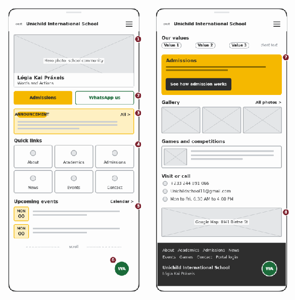

**Figure C1.** Home on a phone. Top of the page on the left, the rest on the right.

- The motto and two buttons, Admissions and WhatsApp, sit in the first screen because they answer what a visitor most often wants (§3).
- One announcement at a time, posted only by the administrator. Quick links reach every section in one tap.

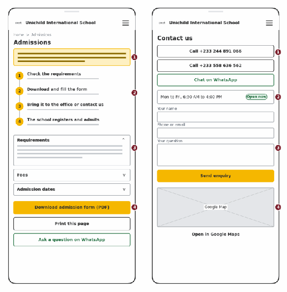

**Figure C2.** Admissions on the left, Contact on the right.

- The first thing on Admissions says that the office completes admission, so parents stop looking for an apply button (§6).
- Requirements, fees and dates are expanding sections. Download form, Print and WhatsApp are the three next steps (§6, §15, §16).
- Contact has tap to call buttons, office hours (Monday to Friday, 6:30 AM to 4:00 PM), a short enquiry form and a map (§16).

**Login, student dashboard and results (portal)**

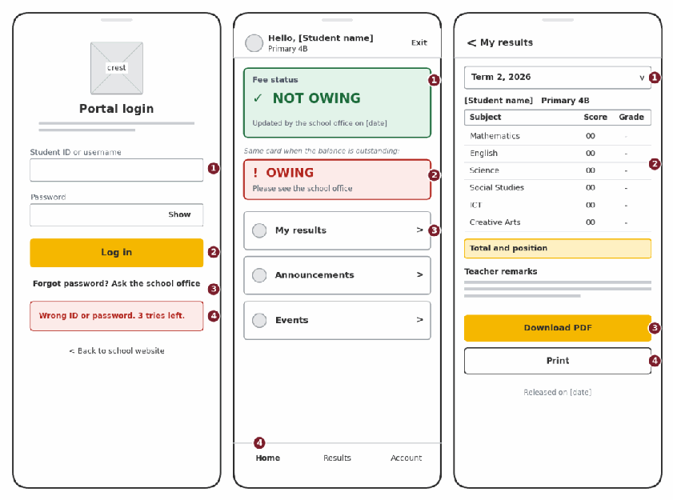

**Figure C3.** Portal login, dashboard with both fee states, and results.

- One login for students and teachers. Wrong details show the tries left and send the user to the school office, because the administrator creates accounts (§7).
- Fee status is a word, an icon and a colour together, with no amount. The brief asks only for the status (§7, §14).
- Results are a plain table with a term selector, Download PDF and Print (§15).

**Administrator and teacher screens (desktop)**

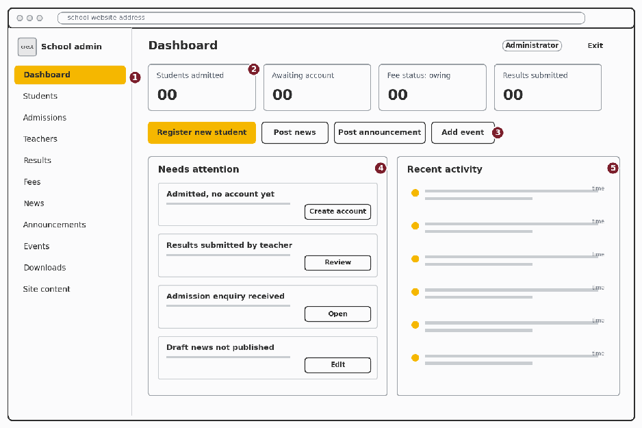

**Figure C4.** Administrator dashboard.

- Counters, one yellow button (Register new student) and a Needs attention list so unfinished work is not forgotten (§9).

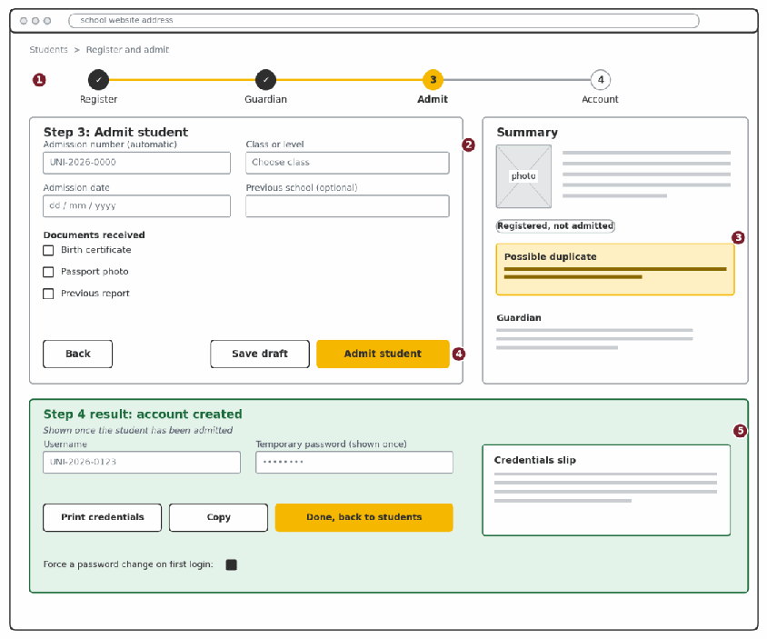

**Figure C5.** Register, admit and create the account, with the step 4 result below.

- Four steps in the order of the brief: register, admit, create account (§6, §7). A draft is saved at each step.
- A possible duplicate is flagged with a warning and never blocked. The password is shown once with a printable slip.

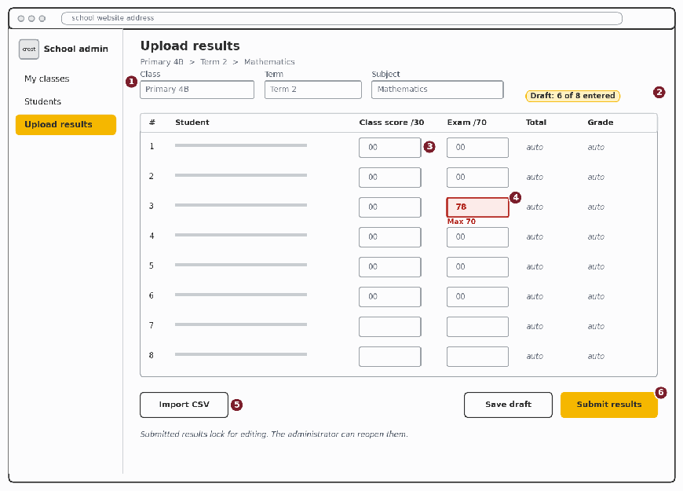

**Figure C6.** Teacher results entry.

- Teachers get two jobs only: view students and upload results (§8). Totals and grades calculate as scores are typed.
- A score above the maximum turns the row red and says the limit in words. The 30 and 70 limits are placeholders until the school confirms its scheme.

**The same screens as a working prototype**

Open the prototype and walk the three core jobs. Home and Admissions need no login. Use the demo logins on the login page for the rest.

**Table C3.** What to try in the prototype

| Screen | What to try | What you should see |
|---|---|---|
| Admissions | Open Fees, press Print | Section expands, print dialog opens |
| Portal login | Enter a wrong password | Tries left, then a pointer to the school office |
| Student dashboard | Use the reviewer link | Fee card flips between NOT OWING and OWING |
| Register and admit | Press Next empty, then type Ama Mensah | Errors under fields, then a duplicate warning, then a one time password |
| Upload results | Type 78 as an exam score | Row turns red with the maximum in words |
| The prototype stores nothing and holds only invented data and demo passwords. Never use real |  |  |
| student information in it. |  |  |

### C.2 Main user flows

Three flows cover the three jobs the system exists to do: get a student in, get results in, and get results out to the family. Red boxes are error paths and dashed arrows are return paths. Each can be walked in the prototype.

**F1 The administrator admits a student and creates the account Actor:** Administrator **Starts when:** a family hands in the admission form at the office **Success:** the pupil is admitted, the account exists and the parent holds a printed login slip

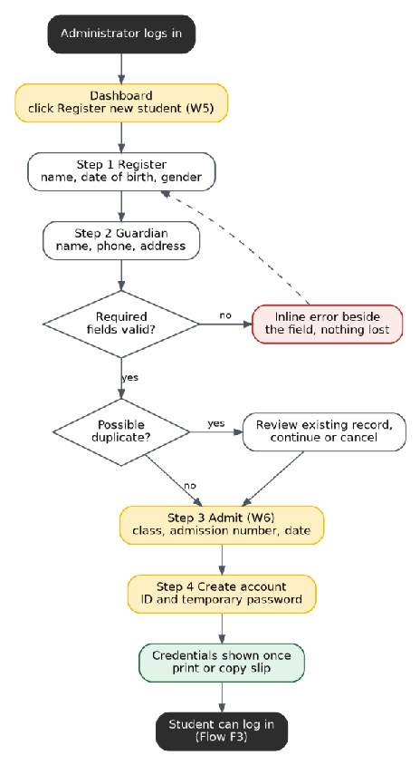

**Figure C7.** F1. The administrator admits a student and creates the account. Edge cases covered

- Interrupted halfway: the draft is kept at every step and shows under Needs attention.
- Required field missing: the error sits beside the field and typed values stay.
- Possible duplicate: a warning, and the administrator decides after reviewing the other record.
- Slip lost: a new temporary password is issued and the old one stops working.

**F2 A teacher uploads class results Actor:** Teacher **Starts when:** marking for a subject is finished **Success:** a complete, validated sheet is submitted and waiting for the administrator

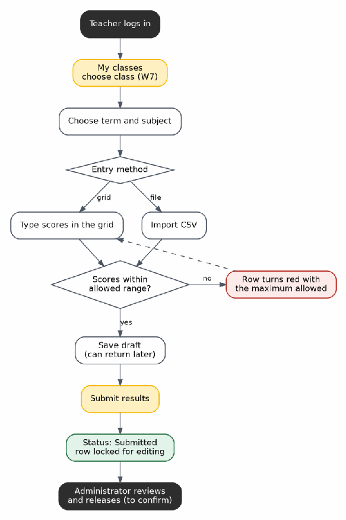

**Figure C8.** F2. A teacher uploads class results. Edge cases covered

- Score above the maximum: the row turns red with the limit in words.
- Interrupted: Save draft keeps progress and shows how many are entered.
- Pupil absent: an Absent option so a blank is not read as zero (planned, not yet in the prototype).
- Wrong score after submitting: the administrator reopens the sheet.

**F3 A student or parent checks results and fee status Actor:** Student or parent **Starts when:** results have been released for the term **Success:** the family sees the fee status and holds a PDF or printout of the results

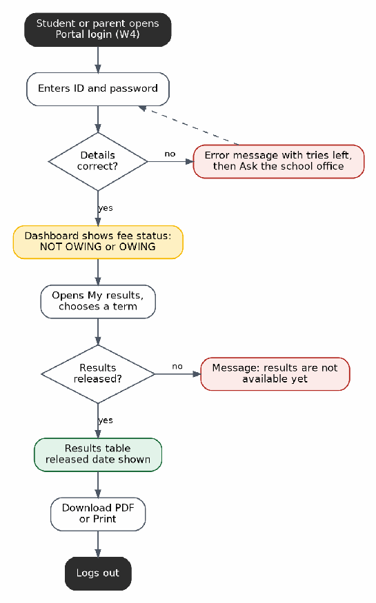

**Figure C9.** F3. A student or parent checks results and fee status. Edge cases covered

- Wrong password: error with tries left, then a pointer to the school office.
- Results not released: a plain message instead of an empty table.
- Fee status is OWING: the card says to see the school office. Whether results are then hidden is a client decision (Q3 in C.4).
- Shared phone: the session should end after inactivity (planned, not yet in the prototype).

### C.3 Usability assumptions and accessibility considerations

**Usability assumptions**

We have not studied Unichild's users. Each assumption below states where it comes from, what it changed in the design, and how we will find out if it is wrong. A basis of team hypothesis means there is no evidence yet.

**Table C4.** Usability assumptions

| ID | Assumption | Basis | Design effect | How we will check |
|---|---|---|---|---|
| A1 | Most parents use Android phones on mobile data | Team hypothesis | Phone first layouts, small pages, text before images | Ask the client and five parents. Test on a mid range phone with a slowed network. |
| A2 | Parents already contact the school on WhatsApp | Client brief §3, §16 | WhatsApp button on every public page | Confirm the monitored number and hours. |
| A3 | The administrator is interrupted often while working | Client brief §9, hours in §16 | Drafts at every step, Needs attention list | Watch an admission with a phone call in the middle. |
| A4 | Teachers mark on paper and type one subject at a time | Team hypothesis | Register order list, live totals | Ask two teachers how they record marks. |
| A5 | Parents log in with the child's account | Client brief §7 (student accounts only) | One login per student | Ask the client (Q4). |
| A6 | Parents understand the word portal | Team hypothesis | Label is Portal login | Label test with three parents. Switch to Student and parent login if two stumble. |
| A7 | Families read fee status as a plain yes or no | Client brief §7, §14 | Badge only, no amount | Show the dashboard to the client. |
| A8 | English is comfortable for staff and parents | Team hypothesis | Plain English, no translation planned | Ask the client. |

**Accessibility considerations**

We aim for WCAG 2.1 level AA. That covers people with disabilities and also people on old phones, weak signal and shared devices.

**Table C5.** Accessibility measures and how each is checked

| Area | What we design for | How we check it |
|---|---|---|
| Colour contrast | Charcoal on white is 13.58 to 1. Charcoal on the uniform yellow is 7.61 to 1. White on yellow is 1.78 to 1, which fails, so it is never used. Status red and green are 6.54 to 1 on white. | Measured with the contrast formula. Re run if the brand colours change. |
| Colour is never the only signal | Fee status and errors use a word and an icon as well as colour. | Review in greyscale. |
| Text and zoom | Body text 16 px or more. Layouts reflow at 200 percent without sideways scrolling. | Test at 200 percent and a large phone font. |
| Touch targets | Controls at least 44 px tall with space between them. | Tap test on a real phone. |
| Keyboard | Everything reachable with Tab, visible focus outline, sensible order, skip to content link. | Complete F1 and F2 without a mouse. |
| Screen readers | Real headings, labels tied to fields, alt text on images, header cells in the results table, current step announced. | TalkBack on Android, NVDA on Windows. |
| Forms and errors | Label above every field. Error text next to the field says how to fix it. Typed values are kept. | Walk through with deliberate mistakes. |
| Print and PDF | Print stylesheet. Results PDF is real text with a title and language set. | Open the PDF in a reader and select text. |
| Low bandwidth | Compressed images, no autoplay video or heavy animation. | Slowed network test. |
| Shared devices | No names or IDs in addresses. Logout always visible. Short inactivity timeout. | Review with the D7 security checklist. |

**Automated check already run**

We ran axe-core with the WCAG 2.1 A and AA rule sets on ten prototype screens. The first run found one defect on three screens: the floating WhatsApp button displayed the text WA but was named Chat with the school on WhatsApp, so voice control and screen reader users would not match what they saw to what they heard. We renamed it so the visible text comes first, and the second run reported no violations. Automated tools find only part of the problems, so the keyboard, screen reader, zoom and print checks above still have to be done by hand. [Record the date and result of each manual check.]

### C.4 Evidence of review by an intended user or client representative

This section must describe a real session. Send the client the prototype link first so they can open it on their own phone, then fill in the highlighted items afterwards from what actually happened.

**Table C6.** Review session record **Status** [Completed on (date) / Scheduled for (date)] **Reviewer name and role** [Name, role at the school] **Type of reviewer** [Client representative / administrator / teacher / parent / office staff] **Date, time and duration** [Date, start time, minutes] **Place or channel** [In person / video call / WhatsApp call] **Team members present** [Names] **What was shown** The clickable prototype on [their phone / our laptop] and the wireframes and flows in this document

**Evidence stored in** docs/03_backlog_ux/client_meeting_[YYYY-MM-DD].md with **repository** [photo of the session / screenshot of the confirming message] **Table C7.** Tasks given and what we observed

| Task | Success looks like | What we observed |
|---|---|---|
| Administrator: admit a new pupil and get the parent a login | Reaches the credentials slip without help | [Observed] |
| Teacher: enter Mathematics scores and notice a mistake | Fixes the red row before submitting | [Observed] |
| Parent: find out if the child owes fees and get the results | Reads the status, opens Results, finds Download PDF | [Observed] |
| Visitor: find admission fees and ask the school a question | Reaches Admissions in one tap and picks a contact option | [Observed] |

**Table C8.** Feedback log

| # | Screen | What the reviewer said or did | Decision | Change made and where |
|---|---|---|---|---|
| 1 | [Screen] | [Comment] | [Accepted / Changed / Rejected / Deferred] | [What changed, issue or PR link] |
| 2 | [Screen] | [Comment] | [Decision] | [Change, link] |
| 3 | [Screen] | [Comment] | [Decision] | [Change, link] |
| 4 | [Screen] | [Comment] | [Decision] | [Change, link] |

**Table C9.** Questions the sketches raised for the client

| ID | Question | Screen |
|---|---|---|
| Q1 | Which number answers WhatsApp, and who replies during office hours? | Home, Contact |
| Q2 | Do results go live when a teacher submits, or does the administrator release them? | Teacher, Admin |
| Q3 | Are results hidden from students who owe fees? | Results |
| Q4 | One account per student shared by the family, or separate parent accounts? | Login |
| Q5 | Who resets forgotten passwords? | Login |
| Q6 | What are the real score limits and grade bands? | Teacher |
| Q7 | What is the policy on photos of children, and who approves them? | Gallery, Games |

**Table C10.** Reviewer confirmation I have used the prototype and seen the sketches and flows for the Unichild International School website and student portal described in this document. They reflect how our school works, apart from the changes recorded in the feedback log.

Name: [full name] Role: [role] Date: [date] Signature or message reference: [signature, or date and time of the confirming message]

**Keep it honest.** A generic, undated or after the fact confirmation is easy to spot and the course lists it as a red flag. A short real message from the client saying what they liked and what to change is worth more than a polished paragraph.

---

## D3 Part D: Sprint 1 Plan

**DEVFORGE**

Uni Child International School Website and Student Information Management System

Team: DevForge Course: DCIT 208 – Software Engineering Submission deadline: 23 October 2026 Planning status: Draft for team confirmation

### 1. Sprint Overview

Sprint 1 focuses on validating and stabilising the existing implementation of the Uni Child International School public website and Student Information Management System. The team has completed the initial coding and wireframes; however, comprehensive testing is still required. The sprint will prioritise functional verification, integration checks, security and access- control testing, defect correction, and preparation of a demonstrable prototype. Proposed planning window: 19–23 October 2026, subject to confirmation against the team's actual sprint dates. Amend these dates if they do not reflect work actually undertaken.

### 2. Sprint Goal

To verify that the core website and student management features behave according to their acceptance criteria, identify and resolve critical defects, check appropriate access to sensitive student information, and prepare a demonstrable prototype supported by testing evidence.

### 3. Expected Prototype Functionality

- Correct display and navigation of key public website pages.
- Working administrator and teacher authentication, where implemented.
- Student registration and record-viewing workflows, where implemented.
- Appropriate access restrictions for student records.
- Correct display of website content and approved gallery images.
- Evidence of executed tests, documented defects and fixes, and an updated project board. Report outcomes according to actual test results. Any unfinished or failing feature must remain identified as incomplete.

### 4. Sprint Backlog and Ownership

The following are candidate stories for team review, not a final commitment. Confirm exact titles, acceptance criteria, priorities, estimates and dependencies against D3 Part A before selecting approximately 4–6 stories.

| Candidate story | Planned verification | Owner role (replace with |
|---|---|---|
|  |  | name) |
| US-01.1 — Admin logs in securely | Test valid/invalid login, logout and session behaviour. | Backend/Security Lead |
| US-01.2 — Teacher logs in | Test teacher authentication and role permissions. | Backend/Security Lead |
| US-04.1 — Admin enters student information | Test required fields, invalid inputs and validation. | Student System Developer |
| US-04.2 — Admin saves student registration | Test saving, missing fields, duplicate submissions and persistence. | Student System Developer |
| US-07.1 — Admin views student records | Verify correct records are visible to authorised administrators only. | Student System Developer |
| US-08.1 — Teacher views permitted student information | Test role restrictions and prevention of unauthorised access. | Backend/Security Lead |
| US-12.1 — Public school information | Check content display and navigation against the approved story. | Website/Frontend Developer |
| US-20.1 — Gallery | Test image loading, responsive layout and approval for published images. | Website/Frontend Developer |

Replace role labels with actual team-member names. Every selected story must have acceptance criteria, planned tests and an assigned owner. Do not include all candidates automatically. Story-point total and sprint capacity: complete using the estimates in the approved D3 Part A backlog. Do not invent estimates or claim the selected stories fit until the team confirms the total.

### 5. Testing Strategy

Testing will be performed before a story is marked Done. Manual and/or automated tests will be used as appropriate to the existing implementation and available tools.

1. Functional testing: verify that implemented features produce expected results.

2. Input validation: check required fields, invalid inputs and duplicate submissions where applicable.

3. Authentication testing: verify valid and invalid login attempts, logout and session behaviour.

4. Authorisation testing: confirm that each role can access only permitted information and functions.

5. Integration testing: check that related pages, forms, database operations and system functions work together.

6. Responsive and usability testing: check important website screens on mobile and desktop displays.

7. Regression testing: re-test affected functionality after defects are corrected. Record actual test outcomes, defects, corrective actions and supporting screenshots where appropriate. Tests that have not been executed must not be reported as passed.

### 6. Definition of Ready (DoR)

A story is Ready when:

- Its user role, goal and benefit are clear.
- Acceptance criteria are written and understandable.
- Dependencies and preconditions are known.
- It is small enough to complete within the sprint.
- The team knows how it will test the story.
- Its priority has been confirmed by the Product/Client Manager or explicitly marked as an assumption.

### 7. Definition of Done (DoD)

A story is Done when:

- Its acceptance criteria have been met and verified.
- Relevant tests have been added or updated and executed.
- Code has been committed through a branch and pull request rather than unreviewed direct work on the main branch.
- At least one team member other than the author has reviewed the pull request and left a meaningful comment.
- CI checks pass, or an instructor-approved exception is documented.
- Screenshots or demonstration evidence are attached for visible UI changes.
- Relevant documentation, release notes or user instructions are updated where behaviour changes.
- AI assistance is disclosed in the pull request and AI_USAGE.md where applicable.
- The linked GitHub issue is moved to Done only after the acceptance criteria are met.

### 8. Risks and Mitigation

| Risk | Mitigation |
|---|---|
| Insufficient testing time | Prioritise essential workflows and critical defects; select stories according to realistic capacity. |
| Authentication or access-control weaknesses | Test role permissions and access to sensitive student information explicitly. |
| Unresolved defects | Record severity, assign responsibility and document outstanding issues rather than marking them complete. |
| Unconfirmed school information or image permissions | Keep affected content pending confirmation instead of publishing unverified information or unapproved images. |
| Mismatch between report and repository | Reconcile the sprint backlog, GitHub issues, milestone, test evidence and submitted PDF. |

### 9. Sprint Completion Criteria

Sprint 1 will be reviewed against the selected stories and their acceptance criteria. The team will report which stories passed verification, which remain incomplete, the defects identified and corrected, and any outstanding risks. The sprint report and GitHub project board will be kept consistent. The submission will include the sprint backlog, owners, planned tests, Definition of Ready, Definition of Done and available prototype evidence.

### 10. Sprint Review and Deployment Outlook

At the sprint review, DevForge will demonstrate verified functionality, discuss test results and known limitations, and identify remaining work. Only features supported by actual test evidence will be presented as verified. The team currently estimates a further two to three weeks before deployment. This is a planning estimate, not a confirmed release date. Agree on a target date after reviewing testing results, defects, integration and deployment readiness.

### 11. Team Confirmation Before Submission

- Confirm actual sprint start/end dates and amend the proposed dates if needed.
- Select the final 4–6 stories from D3 Part A and confirm exact titles, priorities, acceptance criteria, estimates and dependencies.
- Calculate the selected stories' total story points and compare with realistic sprint capacity.
- Replace role labels with actual owners' names.
- Create or update GitHub issues and link selected stories to the Sprint 1 milestone.
- Record actual test results and attach available prototype screenshots/evidence.
- Ensure the PDF and GitHub project board agree. This checklist is for the team's review. Complete these confirmations and remove this section from the final submitted version if your lecturer expects only the formal plan.

---

## D3 Part E: GitHub Project Board Setup

**Project Board**

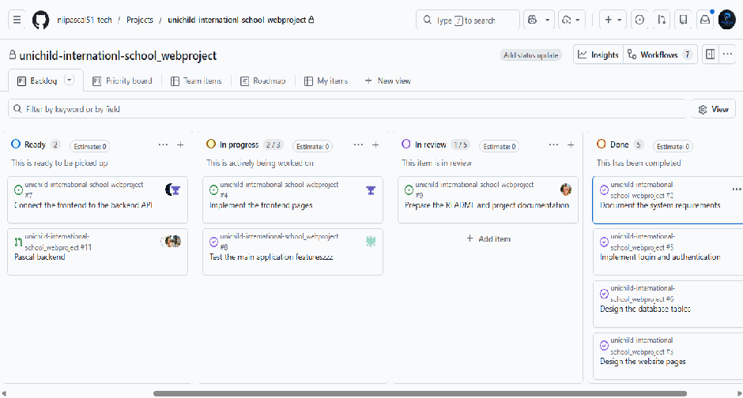

**Issues**

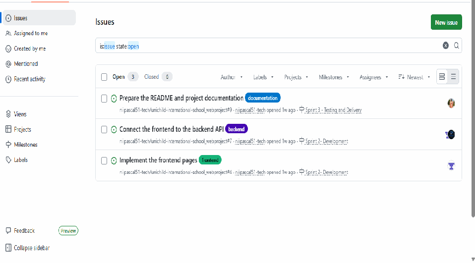

**Milestones**

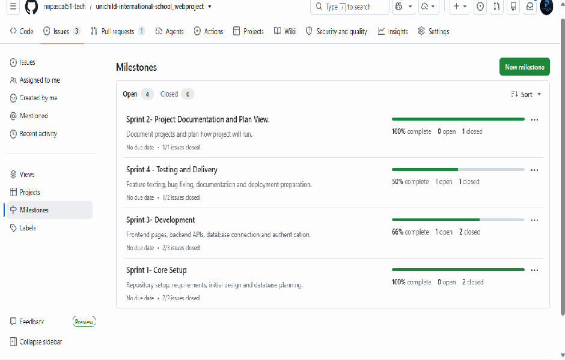

**”**
